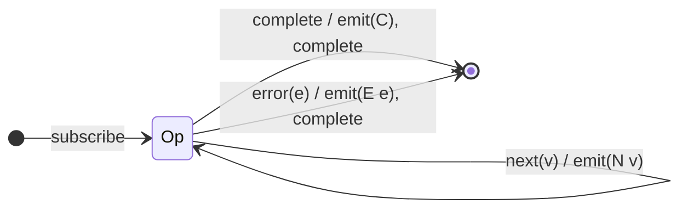

# `materialize` as a Mealy Machine

> `materialize()` turns every source **notification** into a `Notification`
> object emitted as a plain `next`, and then **completes normally** — even if the
> source errored. It is the operator that most literally exposes the input
> alphabet Σ as output *data* (Λ values).

Signature:

```ts
materialize<T>(): OperatorFunction<T, Notification<T>>
```

---

## 1. The 6-Tuple  M = (Q, Σ, Λ, δ, λ, q₀)

### Q — States

- `Op` — single operational state.
- `Done` — terminal.

### Σ — Input alphabet

- `next(v)`, `complete`, `error(e)`.

### Λ — Output alphabet

- `emit(Notification)`, `complete`. Note: **`error` is never produced
  downstream** — it is reified into a value.

### δ, λ

Each source notification is wrapped into a `Notification` object and emitted as
a `next`. On source `complete` it emits a `'C'` notification then completes; on
source `error(e)` it emits an `'E'` notification carrying `e`, then
**completes** (does not error).

### q₀ — Initial state

`q₀ = Op`.

---

## 2. State Transition Table (STT)

| # | Current state | Input (Σ)  | Next state | Output (λ)                                       |
|---|---------------|------------|------------|--------------------------------------------------|
| 1 | `Op`          | `next(v)`  | `Op`       | `emit(Notification 'N' v)`                       |
| 2 | `Op`          | `complete` | `Done`     | `emit(Notification 'C')`, then `complete`        |
| 3 | `Op`          | `error(e)` | `Done`     | `emit(Notification 'E' e)`, then `complete` (**not** error) |

Row 3 is the striking edge: a source **error** is reified into a value and the
output completes normally. `materialize` never errors downstream.

---

## 3. State Transition Diagram (STD)



---

## 4. From STT rows to test cases

- **Row 1** — each value arrives wrapped in a `'N'` notification.
- **Row 2** — a `'C'` notification is emitted, then completion.
- **Row 3** — a source error becomes an `'E'` notification and the output
  **completes** (assert no `error` marble downstream).

See [`tests/19-materialize.test.ts`](../../tests/19-materialize.test.ts).

---

## Relationship to the family

`materialize` reifies Σ into Λ; its inverse [`dematerialize`](dematerialize.md)
reads those notifications back. `materialize` then `dematerialize` is the
identity on a stream. See
[`09-transformation-family.md`](../09-transformation-family.md).
