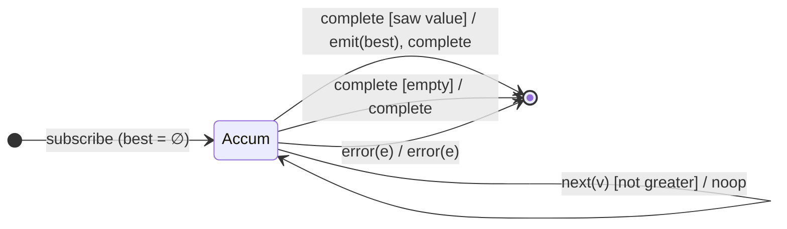

# `max` as a Mealy Machine

> `max(comparer?)` folds the stream into its **largest** value, emitted on
> completion. It is `reduce` keeping a running extreme: the first value seeds the
> candidate; an empty source completes with **no emission** (like seedless
> `reduce`).

Signature:

```ts
max<T>(comparer?: (a: T, b: T) => number)
```

---

## 1. The 6-Tuple  M = (Q, Σ, Λ, δ, λ, q₀)

### Q — States

- `Accum(best?)` — the running maximum (`∅` until the first value).
- `Done` — terminal.

### Σ — Input alphabet

- `next(v)`, `complete`, `error(e)`.

### Λ — Output alphabet

- `emit(x)`, `complete`, `error(e)`, `noop`.

### δ, λ

The first value seeds `best`; each subsequent value replaces `best` if it is
greater (per `comparer`). All silent. On `complete`, emit `best` if any value
was seen, else complete with nothing.

### q₀ — Initial state

`q₀ = Accum(∅)`.

---

## 2. State Transition Table (STT)

| # | State       | Input (Σ)  | Guard           | Next state   | Output (λ)             |
|---|-------------|------------|-----------------|--------------|------------------------|
| 1 | `Accum(∅)`  | `next(v)`  | —               | `Accum(v)`   | `noop` (seed)          |
| 2 | `Accum(b)`  | `next(v)`  | `v` beats `b`   | `Accum(v)`   | `noop`                 |
| 3 | `Accum(b)`  | `next(v)`  | `v` not greater | `Accum(b)`   | `noop`                 |
| 4 | `Accum(b)`  | `complete` | saw ≥ 1         | `Done`       | `emit(b)`, `complete`  |
| 5 | `Accum(∅)`  | `complete` | empty           | `Done`       | `complete` (no value)  |
| 6 | any         | `error(e)` | —               | `Done`       | `error(e)`             |

Row 5 is the key contrast with [`toArray`](toArray.md): seedless, so an empty
source yields no emission.

---

## 3. State Transition Diagram (STD)



---

## 4. From STT rows to test cases

- **Rows 1–4** — emits the largest value on completion.
- **Custom comparer** — a comparer reverses/customises the ordering.
- **Row 5** — empty source completes with no value.

See [`tests/42-max.test.ts`](../../tests/42-max.test.ts).

---

## Relationship to the family

`max` and [`min`](min.md) are the same running-extreme machine with opposite
comparisons — emit-on-complete folds that, unlike [`toArray`](toArray.md), emit
nothing on an empty source. See
[`11-aggregation-family.md`](../11-aggregation-family.md).
