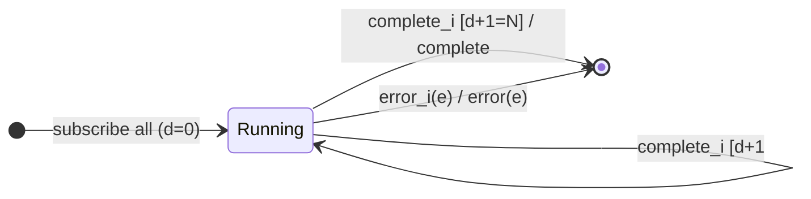

# `merge` as a Mealy Machine

> `merge(...sources, concurrent?)` subscribes to all sources **at once** and
> forwards their values **interleaved by time** (no combination). It completes
> only when **every** source has completed. It is [`concat`](concat.md) without
> the one-at-a-time ordering — the fixed-list analogue of `mergeMap`.

Signature:

```ts
merge<T extends readonly ObservableInput<unknown>[]>(...sourcesAndConcurrent: [...T, number?])
```

---

## 1. The 6-Tuple  M = (Q, Σ, Λ, δ, λ, q₀)

### Q — States

- `Running(doneCount)` — how many sources have completed.
- `Done` — terminal.

### Σ — Input alphabet (N sources)

- `next_i(v)`, `complete_i`, `error_i(e)`.

### Λ — Output alphabet

- `emit(v)`, `complete`, `error(e)`, `noop`.

### δ, λ

All sources are subscribed (up to `concurrent`); each value forwards
immediately, interleaving by arrival time. Output completes only when all N
sources have completed.

### q₀ — Initial state

`q₀ = Running(0)`.

---

## 2. State Transition Table (STT)

| # | State        | Input        | Guard       | Next / Output                    |
|---|--------------|--------------|-------------|----------------------------------|
| 1 | `Running(d)` | `next_i(v)`  | —           | `emit(v)` (interleaved by time)  |
| 2 | `Running(d)` | `complete_i` | `d+1 < N`   | `Running(d+1)`; `noop`           |
| 3 | `Running(d)` | `complete_i` | `d+1 = N`   | `Done`; `complete`               |
| 4 | any          | `error_i(e)` | —           | `Done`; `error(e)`               |

Row 3 is the completion gate: all sources must finish.

---

## 3. State Transition Diagram (STD)



---

## 4. From STT rows to test cases

- **Rows 3/4** — completes only after every source completes (demonstrated with
  a synchronous group whose parentheses advance the virtual clock).

See [`tests/57c-merge.test.ts`](../../tests/57c-merge.test.ts).

---

## Relationship to the family

`merge` is the interleave strategy; [`mergeWith`](mergeWith.md) is its pipeable
form. `concat` is `merge` with `concurrent = 1` and preserved order. See
[`13-combination-family.md`](../13-combination-family.md).
