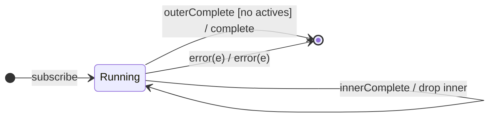

# `mergeAll` as a Mealy Machine

> `mergeAll(concurrent?)` flattens a **higher-order Observable** (a source that
> emits Observables) by subscribing to every inner and interleaving their
> emissions. It is `mergeMap(identity)` — the **merge policy** with the
> projection fixed to the identity, since the source already emits the inners.

Signature:

```ts
mergeAll<T>(concurrent = Infinity)
```

---

## 1. The 6-Tuple  M = (Q, Σ, Λ, δ, λ, q₀)

Identical skeleton to [`mergeMap`](mergeMap.md), with `project = identity` (each
`outerNext` **is** an inner Observable).

### Q — States

- `Running(actives, buffer, outerDone)`, `Done`.

### Σ / Λ

- Σ: `outerNext(inner)`, `outerComplete`, `outerError(e)`, and inner
  notifications. Λ: `emit(x)`, `complete`, `error(e)`, `noop`.

### δ, λ

Each `outerNext(inner)` subscribes `inner` directly (up to `concurrent`); inner
values forward. `q₀ = Running(∅, ∅, false)`.

---

## 2. State Transition Table (STT)

| # | State               | Input               | Guard               | Next / Output                        |
|---|---------------------|---------------------|---------------------|--------------------------------------|
| U1| `Running(A,B,_)`    | `innerNext_i(x)`    | —                   | `emit(x)`                            |
| M1| `Running(A,B,_)`    | `outerNext(inner)`  | `\|A\| < concurrent`| subscribe `inner`; `A∪{i}`; `noop`   |
| M2| `Running(A,B,_)`    | `outerNext(inner)`  | `\|A\| = concurrent`| enqueue; `noop`                      |
| M3| `Running(A,B,_)`    | `innerComplete_i`   | —                   | `A\{i}` (+ drain buffer); `noop`     |
| U4| `Running(∅,∅,true)` | (last inner done)   | outer done          | `complete`                           |
| U2/U3| `Running(…)`     | inner/outer error   | —                   | `error(e)` → `Done`                  |

---

## 3. State Transition Diagram (STD)



---

## 4. From STT rows to test cases

- **U1 + M1** — inner observables run concurrently; outputs interleave.
- **U4** — completes only after the outer and all inners finish.

See [`tests/53a-mergeAll.test.ts`](../../tests/53a-mergeAll.test.ts).

---

## Relationship to the family

`mergeAll()` = [`mergeMap`](mergeMap.md)`(identity)`; `concatAll()` =
`mergeAll(1)`. See [`12-flattening-family.md`](../12-flattening-family.md).
