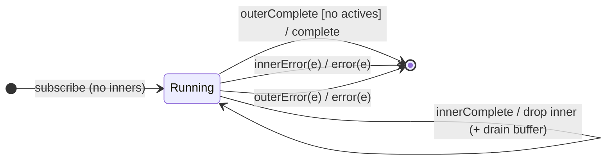

# `mergeMap` as a Mealy Machine

> `mergeMap(project, concurrent?)` maps each source value to an **inner
> Observable** and subscribes to all of them concurrently (up to `concurrent`),
> **interleaving** their emissions into one output. It is the base machine of
> the flattening family — the **merge policy**: *run every inner*.

Signature:

```ts
mergeMap<T, R>(project: (value: T, index: number) => ObservableInput<R>, concurrent = Infinity)
```

---

## 1. The 6-Tuple  M = (Q, Σ, Λ, δ, λ, q₀)

### Q — States

- `Running(actives, buffer, outerDone)` — set of active inner subscriptions, a
  FIFO of outer values waiting for a concurrency slot, and whether the outer has
  completed.
- `Done` — terminal.

### Σ — Input alphabet (outer + dynamic inners)

- Outer: `outerNext(v)`, `outerComplete`, `outerError(e)`.
- Inner `i`: `innerNext_i(x)`, `innerComplete_i`, `innerError_i(e)`.

### Λ — Output alphabet

- `emit(x)`, `complete`, `error(e)`, `noop`.

### δ, λ

Every inner `next` is forwarded (`emit`). A source value subscribes a new inner
if under the concurrency limit, else it is buffered. Output completes only when
the outer is done **and** no inners remain **and** the buffer is empty.

### q₀ — Initial state

`q₀ = Running(∅, ∅, false)`.

---

## 2. State Transition Table (STT)

| # | State                | Input             | Guard                  | Next state / Output                       |
|---|----------------------|-------------------|------------------------|-------------------------------------------|
| U1| `Running(A,B,_)`     | `innerNext_i(x)`  | —                      | `emit(x)`                                 |
| M1| `Running(A,B,_)`     | `outerNext(v)`    | `\|A\| < concurrent`   | subscribe `project(v)`; `A∪{i}`; `noop`   |
| M2| `Running(A,B,_)`     | `outerNext(v)`    | `\|A\| = concurrent`   | enqueue `v` in `B`; `noop`                |
| M3| `Running(A,B,_)`     | `innerComplete_i` | `B` non-empty          | `A\{i}`; dequeue & subscribe next; `noop` |
| M4| `Running(A,B,_)`     | `innerComplete_i` | `B` empty              | `A\{i}`; `noop`                           |
| U4| `Running(∅,∅,true)`  | (last inner done) | outer done, no actives | `complete`                                |
| U2| `Running(A,B,_)`     | `innerError_i(e)` | —                      | `error(e)` → `Done`                       |
| U3| `Running(A,B,_)`     | `outerError(e)`   | —                      | `error(e)` → `Done`                       |

With the default `concurrent = Infinity`, M2/M3 never fire — all inners run at
once and output interleaves.

---

## 3. State Transition Diagram (STD)



---

## 4. From STT rows to test cases

- **U1 + M1** — concurrent inners; outputs interleave by time.
- **U4** — output stays open until the last inner finishes.
- **Concurrency** — `mergeMap(p, 1)` degrades to the concat (queue) policy.

See [`tests/49-mergeMap.test.ts`](../../tests/49-mergeMap.test.ts).

---

## Relationship to the family

`mergeMap` is the base skeleton; [`concatMap`](concatMap.md) is
`mergeMap(·, 1)`, [`mergeAll`](mergeAll.md) is `mergeMap(identity)`, and
[`mergeMapTo`](mergeMapTo.md) is `mergeMap(() => inner)`. The merge policy is
*run*; switch/exhaust/concat are the other three δ policies. See
[`12-flattening-family.md`](../12-flattening-family.md).
