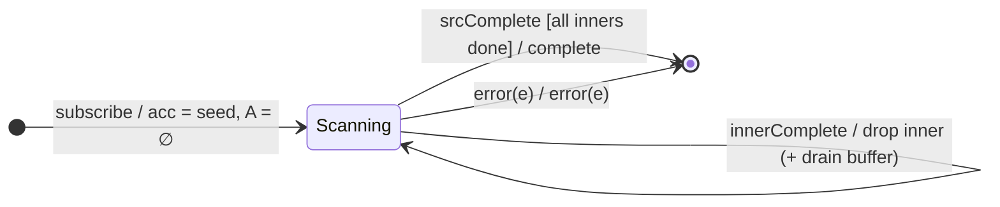

# `mergeScan` as a Mealy Machine

> `mergeScan(accumulator, seed, concurrent?)` is `scan` whose accumulator returns
> an **inner Observable**; the operator subscribes to it and feeds each inner
> emission back as the next accumulator value **and** emits it downstream. The
> state therefore gains **inner-subscription bookkeeping** (a set of active
> inners bounded by `concurrent`).

Signature:

```ts
mergeScan<V, A>(
  accumulator: (acc: A, value: V, index: number) => ObservableInput<A>,
  seed: A,
  concurrent = Infinity
)
```

---

## 1. The 6-Tuple  M = (Q, Σ, Λ, δ, λ, q₀)

### Q — States

- `Scanning(acc, A)` — current accumulator `acc` and set of active inner
  subscriptions `A` (possibly with a buffer of pending source values when at the
  concurrency limit).
- `Done` — terminal.

### Σ — Input alphabet

Two alphabets (source + inners):

- Source: `next(v)`, `complete`, `error(e)`.
- Inner: `innerNext(r)`, `innerComplete(i)`, `innerError(e)`.

### Λ — Output alphabet

- `emit(r)`, `complete`, `error(e)`, `noop`.

### δ, λ

A source `next(v)` calls `accumulator(acc, v, i)` to get an inner, and subscribes
it (or buffers if `|A| = concurrent`). Each `innerNext(r)` **updates the
accumulator** to `r` and emits `r`. Completion requires the source **and** all
inners to be done.

### q₀ — Initial state

`q₀ = Scanning(seed, ∅)`.

---

## 2. State Transition Table (STT)

| # | Current state     | Input             | Guard                 | Next state                     | Output (λ) |
|---|-------------------|-------------------|-----------------------|--------------------------------|------------|
| 1 | `Scanning(s, A)`  | `next(v)`         | `\|A\| < concurrent`  | subscribe inner; `A ∪ {i}`     | `noop`     |
| 2 | `Scanning(s, A)`  | `next(v)`         | `\|A\| = concurrent`  | buffer `v`                     | `noop`     |
| 3 | `Scanning(s, A)`  | `innerNext(r)`    | —                     | `Scanning(r, A)`               | `emit(r)`  |
| 4 | `Scanning(s, A)`  | `innerComplete(i)`| buffer non-empty      | `A \ {i}`; subscribe next buffered | `noop` |
| 5 | `Scanning(s, A)`  | `innerComplete(i)`| buffer empty          | `A \ {i}`                      | `noop`     |
| 6 | `Scanning(s, ∅)`  | `srcComplete`     | all inners done       | `Done`                         | `complete` |
| 7 | any               | `error(e)`        | source or inner       | `Done`                         | `error(e)` |

---

## 3. State Transition Diagram (STD)



---

## 4. From STT rows to test cases

- **Row 3** — inner emissions become the new accumulator and are emitted.
- **Rows 1/6** — completion waits for source and all inners.
- **Row 7** — an inner (or source) error propagates.

See [`tests/16-mergeScan.test.ts`](../../tests/16-mergeScan.test.ts).

---

## Relationship to the family

`mergeScan` is the merge-flavoured higher-order `scan`; [`switchScan`](switchScan.md)
is its switch-flavoured sibling (concurrency 1 + cancel-previous). The four
flattening policies they draw from are covered fully in Session 6. See
[`09-transformation-family.md`](../09-transformation-family.md).
