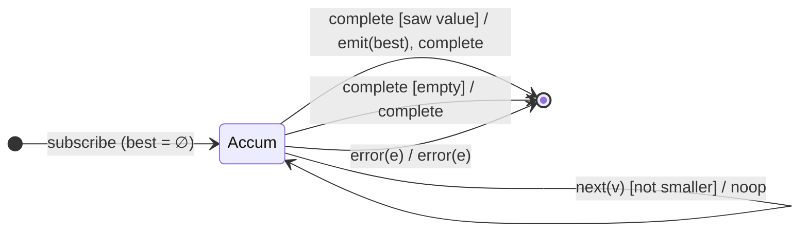

# `min` as a Mealy Machine

> `min(comparer?)` folds the stream into its **smallest** value, emitted on
> completion. It is [`max`](max.md) with the comparison inverted — the same
> running-extreme machine, a different guard. An empty source completes with no
> emission.

Signature:

```ts
min<T>(comparer?: (a: T, b: T) => number)
```

---

## 1. The 6-Tuple  M = (Q, Σ, Λ, δ, λ, q₀)

### Q — States

- `Accum(best?)` — the running minimum (`∅` until the first value).
- `Done` — terminal.

### Σ — Input alphabet

- `next(v)`, `complete`, `error(e)`.

### Λ — Output alphabet

- `emit(x)`, `complete`, `error(e)`, `noop`.

### δ, λ

The first value seeds `best`; each subsequent value replaces `best` if it is
smaller (per `comparer`). All silent. On `complete`, emit `best` if any value
was seen, else complete with nothing.

### q₀ — Initial state

`q₀ = Accum(∅)`.

---

## 2. State Transition Table (STT)

| # | State       | Input (Σ)  | Guard            | Next state   | Output (λ)             |
|---|-------------|------------|------------------|--------------|------------------------|
| 1 | `Accum(∅)`  | `next(v)`  | —                | `Accum(v)`   | `noop` (seed)          |
| 2 | `Accum(b)`  | `next(v)`  | `v` beats `b`    | `Accum(v)`   | `noop`                 |
| 3 | `Accum(b)`  | `next(v)`  | `v` not smaller  | `Accum(b)`   | `noop`                 |
| 4 | `Accum(b)`  | `complete` | saw ≥ 1          | `Done`       | `emit(b)`, `complete`  |
| 5 | `Accum(∅)`  | `complete` | empty            | `Done`       | `complete` (no value)  |
| 6 | any         | `error(e)` | —                | `Done`       | `error(e)`             |

---

## 3. State Transition Diagram (STD)



---

## 4. From STT rows to test cases

- **Rows 1–4** — emits the smallest value on completion.
- **Custom comparer** — a comparer customises the ordering.
- **Row 5** — empty source completes with no value.

See [`tests/43-min.test.ts`](../../tests/43-min.test.ts).

---

## Relationship to the family

`min` is [`max`](max.md) with an inverted comparison — a mirror pair, both
emit-on-complete folds. See
[`11-aggregation-family.md`](../11-aggregation-family.md).
