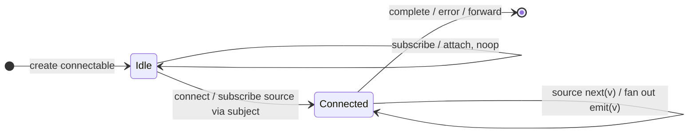

# `multicast` as a Mealy Machine

> `multicast(subjectFactory)` returns a **`ConnectableObservable`**: the source
> does **not** run until you call `.connect()` manually (or wrap it with
> [`refCount`](refCount.md)). It is the classic multicast plumbing — the
> Cold⇄Hot skeleton with a **manual** connect policy and a pluggable Subject.
> (Deprecated in favour of [`connect`](connect.md)/[`share`](share.md).)

Signature:

```ts
multicast<T>(subjectOrFactory, selector?)
```

---

## 1. The 6-Tuple  M = (Q, Σ, Λ, δ, λ, q₀)

### Q — States

- `Idle` — connectable created, source **not** running.
- `Connected(subject)` — `.connect()` (or `refCount`) has subscribed the source.
- `Done` — terminal.

### Σ — Input alphabet

- `connect` meta-event, plus source `next(v)`/`complete`/`error(e)`, plus
  subscriber attach/detach.

### Λ — Output alphabet

- `emit(v)` fanned to subscribers; `complete`, `error(e)`, `noop`.

### δ, λ

Subscribers attach while `Idle` but receive nothing until `connect` runs the
source. After connecting, each source value fans out through the Subject.

### q₀ — Initial state

`q₀ = Idle`.

---

## 2. State Transition Table (STT)

| # | State            | Input            | Next / Output                               |
|---|------------------|------------------|---------------------------------------------|
| 1 | `Idle`           | `subscribe`      | attach subscriber; `noop` (source not running)|
| 2 | `Idle`           | `connect`        | subscribe source via subject; `Connected`    |
| 3 | `Connected(S)`   | source `next(v)` | `S.next(v)` → `emit(v)` to all              |
| 4 | `Connected(S)`   | `complete`/`error`| forward to all; `Done`                     |

With [`refCount`](refCount.md), Rows 1-2 are automated (connect on first
subscriber).

---

## 3. State Transition Diagram (STD)



---

## 4. From STT rows to test cases

- `multicast(() => new Subject())` + `refCount` equals `publish()` + `refCount`
  (one shared source run).

See [`tests/78c-multicast.test.ts`](../../tests/78c-multicast.test.ts).

---

## Relationship to the family

`multicast` is the classic connect primitive; `publish*` = `multicast(() =>
<that subject>)`, and [`refCount`](refCount.md) automates connect/disconnect. The
modern replacement is [`connect`](connect.md)/[`share`](share.md). See
[`16-error-repeat-multicast-family.md`](../16-error-repeat-multicast-family.md).
