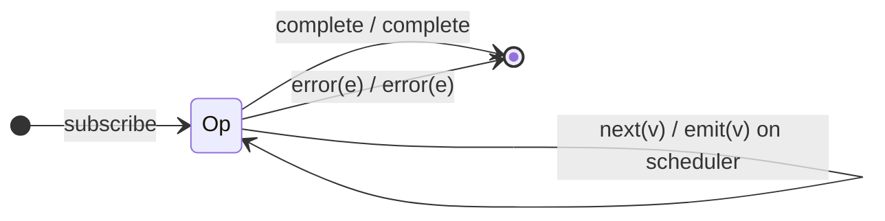

# `observeOn` as a Mealy Machine

> `observeOn(scheduler)` re-schedules each **outgoing** notification onto
> `scheduler`. As a *value* machine it is the **identity** — it emits every value
> unchanged and forwards all terminals; its only effect is *when/where* each
> notification is delivered.

Signature:

```ts
observeOn<T>(scheduler: SchedulerLike, delay = 0)
```

---

## 1. The 6-Tuple  M = (Q, Σ, Λ, δ, λ, q₀)

### Q — States

- `Op` — single operational state.
- `Done` — terminal.

### Σ — Input alphabet

- `next(v)`, `complete`, `error(e)`.

### Λ — Output alphabet

- `emit(v)`, `complete`, `error(e)` — each re-scheduled onto `scheduler`.

### δ, λ

Identity on values and terminals; the notification is merely queued on
`scheduler` (which may introduce a frame of delay in real time; inside
`TestScheduler.run()` with `asyncScheduler` it adds no virtual-time delay).

### q₀ — Initial state

`q₀ = Op`.

---

## 2. State Transition Table (STT)

| # | State | Input (Σ)  | Next  | Output (λ)                       |
|---|-------|------------|-------|----------------------------------|
| 1 | `Op`  | `next(v)`  | `Op`  | `emit(v)` (scheduled on scheduler)|
| 2 | `Op`  | `complete` | `Done`| `complete` (scheduled)           |
| 3 | `Op`  | `error(e)` | `Done`| `error(e)` (scheduled)           |

---

## 3. State Transition Diagram (STD)



---

## 4. From STT rows to test cases

- **Row 1** — values are identical; each is re-scheduled onto the scheduler
  (no virtual-time delay under `TestScheduler.run()`).

See [`tests/67a-observeOn.test.ts`](../../tests/67a-observeOn.test.ts).

---

## Relationship to the family

`observeOn` re-schedules *outgoing* notifications; [`subscribeOn`](subscribeOn.md)
schedules the *subscription* itself. Both are identity value machines. See
[`14-time-family.md`](../14-time-family.md).
