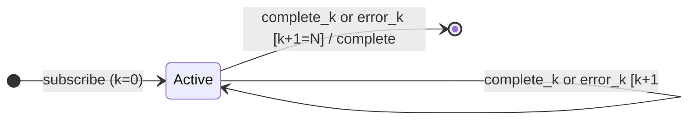

# `onErrorResumeNextWith` as a Mealy Machine

> `onErrorResumeNextWith(...sources)` runs each source in turn; when one
> **errors OR completes**, it quietly moves to the next; when the list is
> exhausted, it completes. **Errors never reach the output** — it is `concat`
> that is immune to errors.

Signature:

```ts
onErrorResumeNextWith<T>(...sources: ObservableInput<any>[])
```

---

## 1. The 6-Tuple  M = (Q, Σ, Λ, δ, λ, q₀)

### Q — States

- `Active(k)` — source `k` is running.
- `Done` — terminal.

### Σ — Input alphabet

- `next(v)`, `complete_k`, `error_k(e)` for the active source `k`.

### Λ — Output alphabet

- `emit(v)`, `complete`, `noop`. (No `error` is ever produced downstream.)

### δ, λ

Values from the active source pass through. **Both** `complete` and `error`
advance to the next source — the error is swallowed. After the last source, the
output completes.

### q₀ — Initial state

`q₀ = Active(0)`.

---

## 2. State Transition Table (STT)

| # | State       | Input         | Next / Output                                   |
|---|-------------|---------------|-------------------------------------------------|
| 1 | `Active(k)` | `next(v)`     | `emit(v)`                                        |
| 2 | `Active(k)` | `complete_k`  | `k+1 < N`: `Active(k+1)`; else `Done`, `complete`|
| 3 | `Active(k)` | `error_k(e)`  | **same as complete** — advance; error swallowed  |

Row 3 is the distinctive edge: an error is treated exactly like completion.

---

## 3. State Transition Diagram (STD)



---

## 4. From STT rows to test cases

- **Row 3** — an error on one source is swallowed and the output moves to the
  next source.

See [`tests/74b-onErrorResumeNextWith.test.ts`](../../tests/74b-onErrorResumeNextWith.test.ts).

---

## Relationship to the family

`onErrorResumeNextWith` is error-immune `concat`; contrast with
[`catchError`](catchError.md) (swap to a chosen fallback). See
[`16-error-repeat-multicast-family.md`](../16-error-repeat-multicast-family.md).
