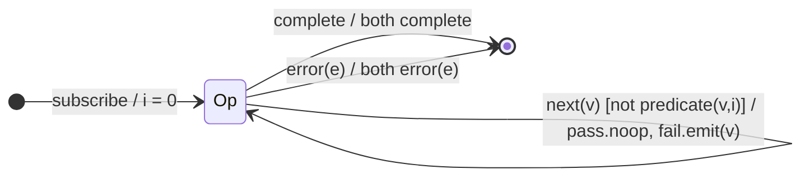

# `partition` as a Mealy Machine

> `partition(predicate)` splits one source into a **tuple of two Observables**
> `[pass, fail]`. It is `[filter(p), filter(¬p)]` sharing a single source: on
> each `next(v)` exactly one of the two output channels emits, decided by the
> guard. It is the first operator whose output alphabet Λ is a **pair of
> channels**.

Signature (in RxJS 7 it is a standalone function, not a pipeable operator):

```ts
partition<T>(source, predicate: (value: T, index: number) => boolean): [Observable<T>, Observable<T>]
```

---

## 1. The 6-Tuple  M = (Q, Σ, Λ, δ, λ, q₀)

### Q — States

- `Op` — single operational state (no memory beyond the index).
- `Done` — terminal (both channels terminate together).

### Σ — Input alphabet

- `next(v)`, `complete`, `error(e)`.

### Λ — Output alphabet (a **pair**)

- `(emit_pass(v) | noop, emit_fail(v) | noop)` on `next`; `(complete, complete)`
  and `(error(e), error(e))` on terminals.

### δ, λ

`δ(Op, next) = Op`. The output routes `v` to **exactly one** channel: the
`pass` channel when `predicate(v, i)` is truthy, the `fail` channel otherwise;
the other channel `noop`s.

### q₀ — Initial state

`q₀ = Op`, index `i = 0`.

---

## 2. State Transition Table (STT)

| # | Current state | Input (Σ)  | Guard               | `pass` output | `fail` output |
|---|---------------|------------|---------------------|---------------|---------------|
| 1 | `Op`          | `next(v)`  | `predicate(v,i)`    | `emit(v)`     | `noop`        |
| 2 | `Op`          | `next(v)`  | `!predicate(v,i)`   | `noop`        | `emit(v)`     |
| 3 | `Op`          | `complete` | —                   | `complete`    | `complete`    |
| 4 | `Op`          | `error(e)` | —                   | `error(e)`    | `error(e)`    |

Both channels complete/error together (Rows 3–4).

---

## 3. State Transition Diagram (STD)



---

## 4. From STT rows to test cases

- **Row 1** — truthy values appear on `pass`, absent from `fail`.
- **Row 2** — falsy values appear on `fail`, absent from `pass`.
- **Rows 3/4** — both channels complete / error together (assert each
  observable independently).

See [`tests/18-partition.test.ts`](../../tests/18-partition.test.ts).

---

## Relationship to the family

`partition` is two parallel [`filter`](filter.md) machines over one source — the
first operator with a dual-channel Λ, a mini-preview of the multi-output
`window*` operators. See
[`09-transformation-family.md`](../09-transformation-family.md).
