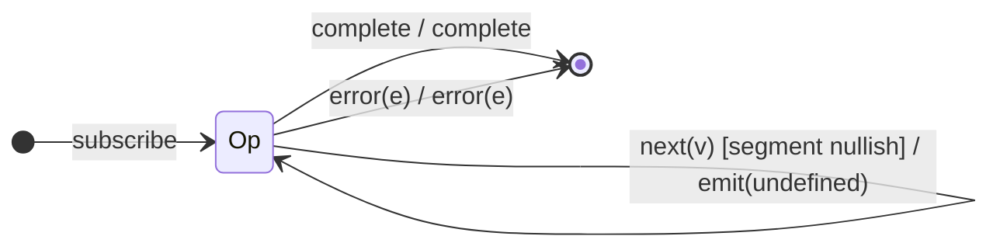

# `pluck` as a Mealy Machine

> `pluck(...keys)` extracts a (possibly nested) property path from every source
> value and emits it. In RxJS 7 it is implemented as a `map` that walks the key
> path, so its machine is `map`'s single-state projector with a path-extraction
> output function. (Deprecated in favour of `map(v => v.a.b)`, but still
> shipped.)

Signature:

```ts
pluck<T, R>(...properties: string[])
```

---

## 1. The 6-Tuple  M = (Q, Σ, Λ, δ, λ, q₀)

### Q — States

- `Op` — single operational state (no memory).
- `Done` — terminal.

### Σ — Input alphabet

- `next(v)`, `complete`, `error(e)`.

### Λ — Output alphabet

- `emit(x)`, `complete`, `error(e)`, `noop`.

### δ, λ

`δ(Op, next) = Op`. The output walks the key path:
`λ = emit(pluckPath(v, keys))`, where walking stops early and yields
`undefined` if any intermediate segment is `null`/`undefined`.

### q₀ — Initial state

`q₀ = Op`.

---

## 2. State Transition Table (STT)

| # | Current state | Input (Σ)  | Guard                       | Next state | Output (λ)                  |
|---|---------------|------------|-----------------------------|------------|-----------------------------|
| 1 | `Op`          | `next(v)`  | full path resolves          | `Op`       | `emit(v[k1][k2]…)`          |
| 2 | `Op`          | `next(v)`  | a segment is nullish        | `Op`       | `emit(undefined)`           |
| 3 | `Op`          | `complete` | —                           | `Done`     | `complete`                  |
| 4 | `Op`          | `error(e)` | —                           | `Done`     | `error(e)`                  |

Rows 1 and 2 share the input symbol `next(v)` and differ only by a guard on
whether the path resolves — so FSM coverage needs both a resolving and a
nullish-path case.

---

## 3. State Transition Diagram (STD)



---

## 4. From STT rows to test cases

- **Row 1** — nested object, assert the deep value is extracted.
- **Row 2** — object missing an intermediate segment → `undefined`.
- **Row 3 / Row 4** — completion / error forwarded.

See [`tests/11-pluck.test.ts`](../../tests/11-pluck.test.ts).

---

## Relationship to the family

`pluck(...keys)` = `map(v => walk(v, keys))`. Single-state projector like
[`map`](map.md), with a guarded output on path resolution. See
[`09-transformation-family.md`](../09-transformation-family.md).
