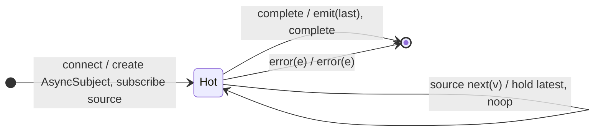

# `publishLast` as a Mealy Machine

> `publishLast()` = `multicast(() => new AsyncSubject())`: a multicast backed by
> an **`AsyncSubject`**, which emits **only the final value, on completion** (to
> all subscribers, whenever they joined). Deprecated in favour of
> [`connect`](connect.md)/[`share`](share.md).

Signature:

```ts
publishLast<T>()   // = multicast(() => new AsyncSubject())
```

---

## 1. The 6-Tuple  M = (Q, Σ, Λ, δ, λ, q₀)

The shared multicast skeleton with the Subject fixed to an `AsyncSubject`:

### Q — States

- `Hot(refCount, asyncSubject)` holding only the **most recent** value (not yet
  emitted); plus `Cold`/`Done`.

### δ, λ

Each source `next(v)` updates the AsyncSubject's held value but emits **nothing**
yet. On source `complete`, the final held value is emitted to all subscribers,
then completion.

### q₀ — Initial state

`q₀ = Cold`.

---

## 2. State Transition Table (STT)

| # | State    | Input            | Next / Output                               |
|---|----------|------------------|---------------------------------------------|
| 1 | `Hot(n)` | source `next(v)` | hold `v` as the latest; `noop`              |
| 2 | `Hot(n)` | `complete`       | `emit(lastHeld)` to all, then `complete`    |
| 3 | `Hot(n)` | `error(e)`       | `error(e)` (no final emit)                  |

Row 2 is the AsyncSubject behaviour: a single emission at completion.

---

## 3. State Transition Diagram (STD)



---

## 4. From STT rows to test cases

- **Rows 1-2** — only the final value `c` is emitted, at the completion frame.

See [`tests/78g-publishLast.test.ts`](../../tests/78g-publishLast.test.ts).

---

## Relationship to the family

`publishLast()` = `multicast(() => new AsyncSubject())` — the emit-only-final
member of the `publish*` set. See
[`16-error-repeat-multicast-family.md`](../16-error-repeat-multicast-family.md).
