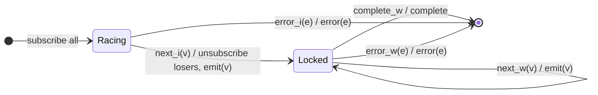

# `race` as a Mealy Machine

> `race(...sources)` subscribes to all sources; the **first one to emit** wins.
> All losers are immediately unsubscribed, and the output thereafter mirrors the
> winner. It is the winner-lock strategy — the lock is triggered by the first
> *emission*, not the first subscription.

Signature:

```ts
race<T extends readonly ObservableInput<unknown>[]>(...sources: [...T])
```

---

## 1. The 6-Tuple  M = (Q, Σ, Λ, δ, λ, q₀)

### Q — States

- `Racing(candidates)` — all sources subscribed, none has emitted yet.
- `Locked(winner)` — the winner has been chosen; losers torn down.
- `Done` — terminal.

### Σ — Input alphabet (N candidates)

- `next_i(v)`, `complete_i`, `error_i(e)`.

### Λ — Output alphabet

- `emit(v)`, `complete`, `error(e)`, `noop`.

### δ, λ

The first `next_i(v)` locks `i` as the winner, unsubscribes all others, and
emits `v`. After locking, the output is a pure pass-through of the winner.

### q₀ — Initial state

`q₀ = Racing(all)`.

---

## 2. State Transition Table (STT)

| # | State         | Input        | Next / Output                                   |
|---|---------------|--------------|-------------------------------------------------|
| 1 | `Racing(C)`   | `next_i(v)`  | unsubscribe all `≠ i`; `Locked(i)`; `emit(v)`   |
| 2 | `Racing(C)`   | `error_i(e)` | `Done`; `error(e)`                              |
| 3 | `Locked(w)`   | `next_w(v)`  | `Locked(w)`; `emit(v)` (mirror the winner)      |
| 4 | `Locked(w)`   | `complete_w` | `Done`; `complete`                              |
| 5 | `Locked(w)`   | `error_w(e)` | `Done`; `error(e)`                              |

Row 1 is the lock: the first emission decides the winner; losers are torn down.

---

## 3. State Transition Diagram (STD)



---

## 4. From STT rows to test cases

- **Row 4** — after locking, output mirrors the winner to completion.
- **Row 1+3** — the first source to emit wins; the loser is dropped.

See [`tests/58a-race.test.ts`](../../tests/58a-race.test.ts).

---

## Relationship to the family

`race` is the winner-lock strategy; [`raceWith`](raceWith.md) is its pipeable
form. See [`13-combination-family.md`](../13-combination-family.md).
