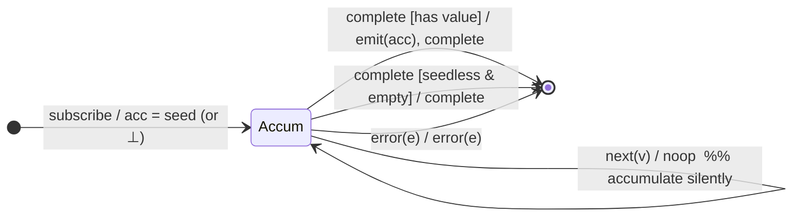

# `reduce` as a Mealy Machine

> `reduce(accumulator, seed?)` folds the whole stream into a **single value
> emitted only on `complete`**. It is `scan` with the output policy inverted:
> same accumulator state, but intermediate emissions are suppressed (`noop`) and
> the accumulated value is flushed once at completion. In RxJS 7 both share
> `scanInternals` — the distinguishing flag is "emit before complete, not on
> next".

Signature:

```ts
reduce<V, A>(accumulator: (acc: A, value: V, index: number) => A, seed?: A)
```

---

## 1. The 6-Tuple  M = (Q, Σ, Λ, δ, λ, q₀)

### Q — States

- `Accum(acc, i, seen)` — holding accumulator `acc`, index `i`, and a `seen`
  flag (has any value arrived?).
- `Done` — terminal.

### Σ — Input alphabet

- `next(v)`, `complete`, `error(e)`.

### Λ — Output alphabet

- `emit(x)`, `complete`, `error(e)`, `noop`.

### δ, λ

Each `next(v)` updates the accumulator **silently** (`λ = noop`). On `complete`
the final accumulator is emitted (if there is one), then completion forwards.

### q₀ — Initial state

`q₀ = Accum(seed, 0, false)` when a seed is given; `Accum(⊥, 0, false)` when
seedless (no accumulator yet; the first value becomes it).

---

## 2. State Transition Table (STT)

| # | Current state            | Input (Σ)  | Guard                      | Next state                      | Output (λ)              |
|---|--------------------------|------------|----------------------------|---------------------------------|-------------------------|
| 1 | `Accum(acc,i,seen)`      | `next(v)`  | —                          | `Accum(f(acc,v,i), i+1, true)`  | `noop` (silent)         |
| 2 | `Accum(acc,_,·)`         | `complete` | has seed **or** `seen`     | `Done`                          | `emit(acc)`, `complete` |
| 3 | `Accum(⊥,_,false)`       | `complete` | seedless **and** empty     | `Done`                          | `complete` (no value)   |
| 4 | any                      | `error(e)` | —                          | `Done`                          | `error(e)` (no flush)   |

- Row 1 accumulates with no emission — the defining contrast with `scan`.
- Row 2 is the single flush-on-complete edge.
- Row 3 is the seedless-empty case: completes **without** emitting (does not
  throw).

---

## 3. State Transition Diagram (STD)



---

## 4. From STT rows to test cases

- **Rows 1+2** — intermediate values silent; one final emission at the complete
  frame.
- **Row 2 (seed, empty)** — empty source with a seed emits the seed.
- **Row 3 (seedless, empty)** — empty source with no seed completes, no value.
- **Row 4** — error forwarded, no final emission.

See [`tests/15-reduce.test.ts`](../../tests/15-reduce.test.ts).

---

## Relationship to the family

`reduce` and `scan` are the same accumulator machine with opposite output
policies — a clean demonstration of the Mealy principle that output lives on the
edge, independent of state structure. See
[`09-transformation-family.md`](../09-transformation-family.md).
