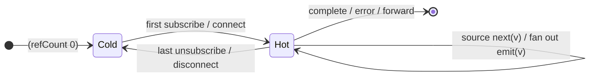

# `refCount` as a Mealy Machine

> `refCount()` turns a `ConnectableObservable` (from [`multicast`](multicast.md)
> or `publish*`) **hot on the first subscriber** and **disconnects on the
> last** — automating the Cold⇄Hot transitions by reference count. It is the
> automation knob of the multicast skeleton.

Signature:

```ts
refCount<T>()   // applied to a ConnectableObservable
```

---

## 1. The 6-Tuple  M = (Q, Σ, Λ, δ, λ, q₀)

### Q — States

- `Cold` — ref-count 0; underlying connectable not connected.
- `Hot(n)` — `n` subscribers; the connectable is connected.
- `Done` — terminal.

### Σ — Input alphabet

- `subscribe` / `unsubscribe` meta-events, plus source
  `next(v)`/`complete`/`error(e)`.

### Λ — Output alphabet

- `emit(v)`, `complete`, `error(e)`, `noop`.

### δ, λ

The first `subscribe` connects the connectable (`Cold → Hot(1)`); each further
subscribe increments the count; the last `unsubscribe` disconnects (`Hot(1) →
Cold`). Source values fan out while hot.

### q₀ — Initial state

`q₀ = Cold`.

---

## 2. State Transition Table (STT)

| # | State    | Input            | Next / Output                               |
|---|----------|------------------|---------------------------------------------|
| 1 | `Cold`   | first `subscribe`| connect connectable; `Hot(1)`               |
| 2 | `Hot(n)` | `subscribe`      | `Hot(n+1)`                                  |
| 3 | `Hot(n)` | source `next(v)` | `emit(v)` to all                            |
| 4 | `Hot(n)` | `unsubscribe`    | `Hot(n-1)`; if `n-1 = 0`, disconnect → `Cold`|
| 5 | `Hot(n)` | `complete`/`error`| forward to all                             |

Rows 1 & 4 are the automation of `multicast`'s manual `connect`.

---

## 3. State Transition Diagram (STD)



---

## 4. From STT rows to test cases

- **Rows 1-4** — connects on the first subscriber; a late subscriber sees only
  values emitted after it joins (one shared source run with a plain Subject).

See [`tests/78d-refCount.test.ts`](../../tests/78d-refCount.test.ts).

---

## Relationship to the family

`refCount` automates the connect/disconnect of [`multicast`](multicast.md)'s
`ConnectableObservable`; [`share`](share.md) bakes this in. See
[`16-error-repeat-multicast-family.md`](../16-error-repeat-multicast-family.md).
