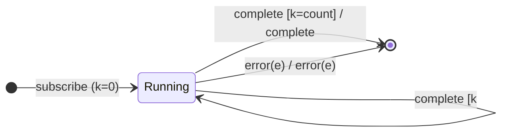

# `repeat` as a Mealy Machine

> `repeat({ count })` **re-subscribes** the source on **complete**, up to `count`
> times, then completes. It is the dual of [`retry`](retry.md): same
> restartable-source FSM, with the loop on the `complete` edge instead of
> `error` (and an error passes straight through).

Signature:

```ts
repeat<T>(countOrConfig?: number | RepeatConfig)
```

---

## 1. The 6-Tuple  M = (Q, Σ, Λ, δ, λ, q₀)

### Q — States

- `Running(k)` — the `k`-th run is active.
- `Done` — terminal.

### Σ — Input alphabet

- `next(v)`, `complete`, `error(e)`, plus `resubscribe`.

### Λ — Output alphabet

- `emit(v)`, `complete`, `error(e)`, `noop`.

### δ, λ

Values pass through. On completion, if runs remain, the source is re-subscribed;
otherwise the output completes. An error aborts the loop immediately.

### q₀ — Initial state

`q₀ = Running(0)`.

---

## 2. State Transition Table (STT)

| # | State        | Input      | Guard       | Next / Output                              |
|---|--------------|------------|-------------|--------------------------------------------|
| 1 | `Running(k)` | `next(v)`  | —           | `Running(k)`; `emit(v)`                    |
| 2 | `Running(k)` | `complete` | `k < count` | **resubscribe**; `Running(k+1)`; `noop`    |
| 3 | `Running(k)` | `complete` | `k = count` | `Done`; `complete`                         |
| 4 | `Running(k)` | `error(e)` | —           | `Done`; `error(e)`                         |

Row 2 is the loop edge (on complete); Row 4 shows an error aborts the loop.

---

## 3. State Transition Diagram (STD)



---

## 4. From STT rows to test cases

- **Rows 1-3** — resubscribes on complete up to `count`, then completes.
- **Row 4** — an error aborts the repeat loop.

See [`tests/75b-repeat.test.ts`](../../tests/75b-repeat.test.ts).

---

## Relationship to the family

`repeat` is [`retry`](retry.md) with the two terminal edges swapped — a clean
duality. [`repeatWhen`](repeatWhen.md) is its notifier-driven generalization.
See [`16-error-repeat-multicast-family.md`](../16-error-repeat-multicast-family.md).
