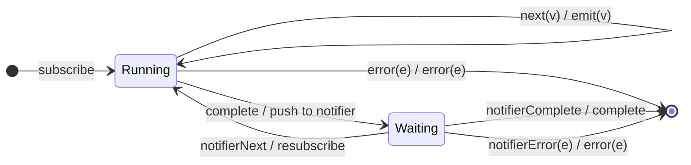

# `repeatWhen` as a Mealy Machine

> `repeatWhen(notifier)` is the **notifier-driven** generalization of
> [`repeat`](repeat.md): on source completion, a signal is fed to a `notifier`
> observable, and the source resubscribes only when the notifier **emits** (and
> terminates when the notifier completes/errors). (Deprecated in RxJS 7 in
> favour of `repeat({ delay })`, but still shipped.)

Signature:

```ts
repeatWhen<T>(notifier: (notifications: Observable<void>) => Observable<any>)
```

---

## 1. The 6-Tuple  M = (Q, Σ, Λ, δ, λ, q₀)

### Q — States

- `Running` — a run is active.
- `Waiting` — the run completed; awaiting the notifier's decision.
- `Done` — terminal.

### Σ — Input alphabet

- `next(v)`, `complete`, `error(e)`, plus `notifierNext` / `notifierComplete` /
  `notifierError`.

### Λ — Output alphabet

- `emit(v)`, `complete`, `error(e)`, `noop`.

### δ, λ

On completion, a notification is pushed into the notifier and the machine waits.
If the notifier emits, resubscribe; if it completes, the output completes; if it
errors, the output errors. A source error passes straight through.

### q₀ — Initial state

`q₀ = Running`.

---

## 2. State Transition Table (STT)

| # | State     | Input              | Next / Output                          |
|---|-----------|--------------------|----------------------------------------|
| 1 | `Running` | `next(v)`          | `Running`; `emit(v)`                   |
| 2 | `Running` | `complete`         | push to notifier; `Waiting`; `noop`    |
| 3 | `Running` | `error(e)`         | `Done`; `error(e)`                     |
| 4 | `Waiting` | `notifierNext`     | resubscribe source; `Running`; `noop`  |
| 5 | `Waiting` | `notifierComplete` | `Done`; `complete`                     |
| 6 | `Waiting` | `notifierError(e)` | `Done`; `error(e)`                     |

---

## 3. State Transition Diagram (STD)



---

## 4. From STT rows to test cases

- **Rows 2-5** — resubscribes when the notifier emits; a completing notifier
  ends the stream after the extra run.

See [`tests/75d-repeatWhen.test.ts`](../../tests/75d-repeatWhen.test.ts).

---

## Relationship to the family

`repeatWhen` is the notifier-driven [`repeat`](repeat.md), the complete-side dual
of [`retryWhen`](retryWhen.md). See
[`16-error-repeat-multicast-family.md`](../16-error-repeat-multicast-family.md).
