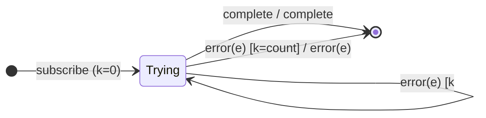

# `retry` as a Mealy Machine

> `retry({ count })` **re-subscribes** the source on error, up to `count` times,
> then lets the error through. Here the source is a **restartable sub-machine**;
> the operator's state counts attempts. `retry()` with no count loops forever on
> error.

Signature:

```ts
retry<T>(configOrCount?: number | RetryConfig)
```

---

## 1. The 6-Tuple  M = (Q, Σ, Λ, δ, λ, q₀)

### Q — States

- `Trying(k)` — the `k`-th attempt is running.
- `Done` — terminal.

### Σ — Input alphabet

- `next(v)`, `complete`, `error(e)`, plus the meta-event `resubscribe`.

### Λ — Output alphabet

- `emit(v)`, `complete`, `error(e)`, `noop`.

### δ, λ

Values and completion pass through. On error, if attempts remain, the source is
**re-subscribed** (re-run) and already-emitted values are re-emitted; otherwise
the error propagates.

### q₀ — Initial state

`q₀ = Trying(0)`.

---

## 2. State Transition Table (STT)

| # | State       | Input      | Guard       | Next / Output                                   |
|---|-------------|------------|-------------|-------------------------------------------------|
| 1 | `Trying(k)` | `next(v)`  | —           | `Trying(k)`; `emit(v)`                          |
| 2 | `Trying(k)` | `complete` | —           | `Done`; `complete`                              |
| 3 | `Trying(k)` | `error(e)` | `k < count` | **resubscribe source**; `Trying(k+1)`; `noop`   |
| 4 | `Trying(k)` | `error(e)` | `k = count` | `Done`; `error(e)` (retries exhausted)          |

Row 3 is the loop edge: on error, resubscribe and re-run the source.

---

## 3. State Transition Diagram (STD)



---

## 4. From STT rows to test cases

- **Rows 1-4** — resubscribes on error up to `count`, then errors out
  (re-emitting already-seen values on each attempt).

See [`tests/75a-retry.test.ts`](../../tests/75a-retry.test.ts).

---

## Relationship to the family

`retry` loops on error / passes complete; [`repeat`](repeat.md) is its dual
(loops on complete / passes error). [`retryWhen`](retryWhen.md) promotes the
counter guard to a notifier. See
[`16-error-repeat-multicast-family.md`](../16-error-repeat-multicast-family.md).
