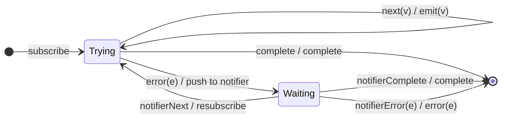

# `retryWhen` as a Mealy Machine

> `retryWhen(notifier)` is the **notifier-driven** generalization of
> [`retry`](retry.md): the error is fed to a `notifier` observable, and the
> source resubscribes only when the notifier **emits** (and terminates when the
> notifier completes/errors). This promotes the counter guard to an external
> signal. (Deprecated in RxJS 7 in favour of `retry({ delay })`, but still
> shipped.)

Signature:

```ts
retryWhen<T>(notifier: (errors: Observable<any>) => Observable<any>)
```

---

## 1. The 6-Tuple  M = (Q, Σ, Λ, δ, λ, q₀)

### Q — States

- `Trying` — an attempt is running.
- `Waiting` — an error occurred; awaiting the notifier's decision.
- `Done` — terminal.

### Σ — Input alphabet

- `next(v)`, `complete`, `error(e)`, plus `notifierNext` / `notifierComplete` /
  `notifierError`.

### Λ — Output alphabet

- `emit(v)`, `complete`, `error(e)`, `noop`.

### δ, λ

On error, the error is pushed into the notifier and the machine waits. If the
notifier emits, resubscribe the source; if the notifier completes, the output
completes; if it errors, the output errors.

### q₀ — Initial state

`q₀ = Trying`.

---

## 2. State Transition Table (STT)

| # | State     | Input              | Next / Output                        |
|---|-----------|--------------------|--------------------------------------|
| 1 | `Trying`  | `next(v)`          | `Trying`; `emit(v)`                  |
| 2 | `Trying`  | `complete`         | `Done`; `complete`                   |
| 3 | `Trying`  | `error(e)`         | push `e` to notifier; `Waiting`; `noop`|
| 4 | `Waiting` | `notifierNext`     | resubscribe source; `Trying`; `noop` |
| 5 | `Waiting` | `notifierComplete` | `Done`; `complete`                   |
| 6 | `Waiting` | `notifierError(e)` | `Done`; `error(e)`                   |

---

## 3. State Transition Diagram (STD)



---

## 4. From STT rows to test cases

- **Rows 3-5** — resubscribes when the notifier emits; a completing notifier
  (e.g. `take(1)`) completes the stream.

See [`tests/75c-retryWhen.test.ts`](../../tests/75c-retryWhen.test.ts).

---

## Relationship to the family

`retryWhen` is the notifier-driven [`retry`](retry.md), like `*Until` in Session
4. Its complete-side dual is [`repeatWhen`](repeatWhen.md). See
[`16-error-repeat-multicast-family.md`](../16-error-repeat-multicast-family.md).
