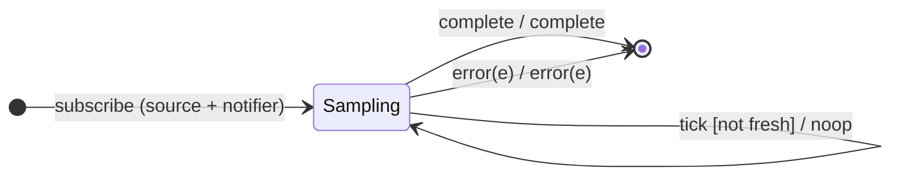

# `sample` as a Mealy Machine

> `sample(notifier)` holds the **latest** source value and emits it whenever the
> `notifier` observable emits — but **only if a new value arrived since the
> previous notifier emission**. It is the notifier-driven generalization of
> [`sampleTime`](sampleTime.md).

Signature:

```ts
sample<T>(notifier: Observable<any>)
```

---

## 1. The 6-Tuple  M = (Q, Σ, Λ, δ, λ, q₀)

### Q — States

- `Sampling(latest?, fresh)` — most recent value and whether it is new since the
  last notifier tick.
- `Done` — terminal.

### Σ — Input alphabet (source + notifier)

- `next(v)`, `complete`, `error(e)`, plus `tick` (notifier emits).

### Λ — Output alphabet

- `emit(x)`, `complete`, `error(e)`, `noop`.

### δ, λ

A `next(v)` stores `v` and sets `fresh`. A notifier `tick` emits the latest value
if `fresh`, else is a no-op.

### q₀ — Initial state

`q₀ = Sampling(∅, false)`.

---

## 2. State Transition Table (STT)

| # | State                | Input      | Guard        | Next / Output                   |
|---|----------------------|------------|--------------|---------------------------------|
| 1 | `Sampling(l, f)`     | `next(v)`  | —            | `Sampling(v, true)`; `noop`     |
| 2 | `Sampling(l, true)`  | `tick`     | fresh value  | `Sampling(l, false)`; `emit(l)` |
| 3 | `Sampling(l, false)` | `tick`     | no new value | `Sampling(l, false)`; `noop`    |
| 4 | any                  | `complete` | —            | `Done`; `complete`              |
| 5 | any                  | `error(e)` | —            | `Done`; `error(e)`              |

---

## 3. State Transition Diagram (STD)



---

## 4. From STT rows to test cases

- **Row 2** — emits the latest value on each notifier emission.
- **Row 3** — a notifier tick with no new value emits nothing.

See [`tests/61b-sample.test.ts`](../../tests/61b-sample.test.ts).

---

## Relationship to the family

`sample` is the notifier generalization of [`sampleTime`](sampleTime.md). See
[`14-time-family.md`](../14-time-family.md).
