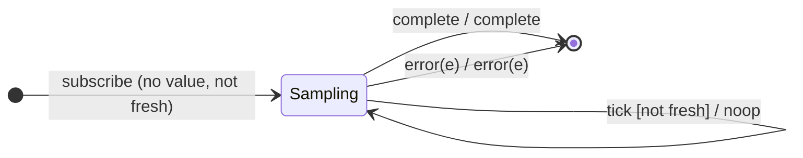

# `sampleTime` as a Mealy Machine

> `sampleTime(d)` holds the **latest** source value and, on each timer tick every
> `d` ms, emits it — but **only if a new value has arrived since the previous
> tick**. It is `sample(interval(d))`.

Signature:

```ts
sampleTime<T>(period: number, scheduler?: SchedulerLike)
```

---

## 1. The 6-Tuple  M = (Q, Σ, Λ, δ, λ, q₀)

### Q — States

- `Sampling(latest?, fresh)` — the most recent value and whether it is new since
  the last tick.
- `Done` — terminal.

### Σ — Input alphabet

- `next(v)`, `complete`, `error(e)`, plus `tick` (the `interval(d)` fires).

### Λ — Output alphabet

- `emit(x)`, `complete`, `error(e)`, `noop`.

### δ, λ

A `next(v)` stores `v` and sets `fresh`. A `tick` emits the latest value only if
`fresh`, then clears `fresh`.

### q₀ — Initial state

`q₀ = Sampling(∅, false)`.

---

## 2. State Transition Table (STT)

| # | State                | Input      | Guard        | Next / Output                   |
|---|----------------------|------------|--------------|---------------------------------|
| 1 | `Sampling(l, f)`     | `next(v)`  | —            | `Sampling(v, true)`; `noop`     |
| 2 | `Sampling(l, true)`  | `tick`     | fresh value  | `Sampling(l, false)`; `emit(l)` |
| 3 | `Sampling(l, false)` | `tick`     | no new value | `Sampling(l, false)`; `noop`    |
| 4 | any                  | `complete` | —            | `Done`; `complete`              |
| 5 | any                  | `error(e)` | —            | `Done`; `error(e)`              |

Row 3 is the key: a tick with no intervening `next` emits nothing (no duplicate).

---

## 3. State Transition Diagram (STD)



---

## 4. From STT rows to test cases

- **Rows 1-3** — emits the latest value at each timer tick; stale ticks are
  no-ops.

See [`tests/61a-sampleTime.test.ts`](../../tests/61a-sampleTime.test.ts).

---

## Relationship to the family

`sampleTime(d)` = [`sample`](sample.md)`(interval(d))`. See
[`14-time-family.md`](../14-time-family.md).
