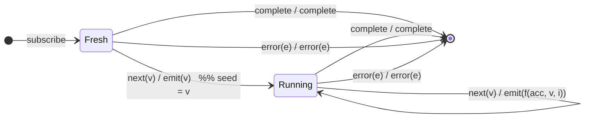

# `scan` (seedless) as a Mealy Machine

> `scan(accumulator)` **without a seed** uses the **first value as the initial
> accumulator** and emits it unchanged; every subsequent value accumulates. This
> adds a genuine *bootstrap* state on top of the seeded `scan`
> ([`01-scan.md`](../01-scan.md)) — the same `S0 → S1` shape as
> `distinctUntilChanged` and `pairwise`.

Signature:

```ts
scan<V>(accumulator: (acc: V, value: V, index: number) => V)   // no seed
```

---

## 1. The 6-Tuple  M = (Q, Σ, Λ, δ, λ, q₀)

### Q — States

- `Fresh` — bootstrap: no accumulator yet.
- `Running(acc, i)` — holding accumulator `acc`, next index `i`.
- `Done` — terminal.

### Σ — Input alphabet

- `next(v)`, `complete`, `error(e)`.

### Λ — Output alphabet

- `emit(x)`, `complete`, `error(e)`, `noop`.

### δ, λ

The first `next(v)` seeds: `Fresh --next(v)--> Running(v, 1) / emit(v)` (emit the
raw first value, not `f(·)`). Thereafter it behaves like seeded `scan`:
`Running(acc,i) --next(v)--> Running(f(acc,v,i), i+1) / emit(f(acc,v,i))`.

### q₀ — Initial state

`q₀ = Fresh`.

---

## 2. State Transition Table (STT)

| # | Current state     | Input (Σ)  | Next state (δ)              | Output (λ)             |
|---|-------------------|------------|-----------------------------|------------------------|
| 1 | `Fresh`           | `next(v)`  | `Running(v, 1)`             | `emit(v)` (seed = v)   |
| 2 | `Running(acc, i)` | `next(v)`  | `Running(f(acc,v,i), i+1)`  | `emit(f(acc,v,i))`     |
| 3 | `Fresh`           | `complete` | `Done`                      | `complete` (no emit)   |
| 4 | `Running(…)`      | `complete` | `Done`                      | `complete`             |
| 5 | any               | `error(e)` | `Done`                      | `error(e)`             |

Row 1 is the bootstrap edge; Row 3 is the empty-source case (completes without
ever emitting).

---

## 3. State Transition Diagram (STD)



---

## 4. From STT rows to test cases

- **Row 1** — first value is emitted unchanged (it becomes the seed).
- **Row 2** — subsequent values accumulate (`f` applied).
- **Row 3** — empty source completes with no emission.
- **Row 5** — error forwarded.

See [`tests/14-scan-seedless.test.ts`](../../tests/14-scan-seedless.test.ts).

---

## Relationship to the family

Seedless `scan` is the seeded `scan` plus a bootstrap state. The same
first-value-latches shape recurs in `pairwise` and `distinctUntilChanged`. Its
emit-on-every-next policy contrasts with [`reduce`](reduce.md)'s
emit-only-on-complete. See
[`09-transformation-family.md`](../09-transformation-family.md).
