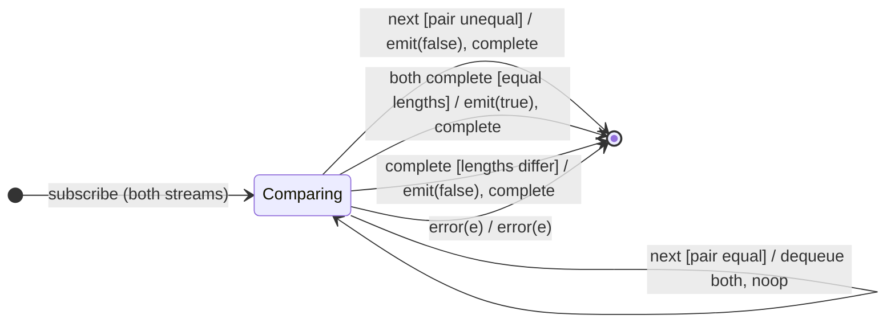

# `sequenceEqual` as a Mealy Machine

> `sequenceEqual(compareTo, comparator?)` compares the source against a second
> observable value-by-value and emits a single `boolean` verdict. It is the
> family's most state-heavy machine: **two FIFO queues** (one per stream) plus
> two done-flags. A mismatch or a length surplus short-circuits to `false`; only
> the `true` verdict waits for both streams to complete.

Signature:

```ts
sequenceEqual<T>(compareTo: Observable<T>, comparator?: (a: T, b: T) => boolean)
```

---

## 1. The 6-Tuple  M = (Q, Σ, Λ, δ, λ, q₀)

### Q — States

- `Comparing(qa, qb, aDone, bDone)` — per-stream queues and completion flags.
- `Done` — terminal.

### Σ — Input alphabet (two streams)

- `aNext(x)`, `aComplete`, `bNext(y)`, `bComplete`, and `error(e)` from either.

### Λ — Output alphabet

- `emit(boolean)`, `complete`, `error(e)`, `noop`.

### δ, λ

When a value arrives and its counterpart queue is empty, it is enqueued (`noop`).
When both queues have a head, they are compared: equal → dequeue both silently;
unequal → `emit(false)` and complete. If one stream completes with the other
still holding extra values, lengths differ → `emit(false)`. If both complete
with queues drained equal → `emit(true)`.

### q₀ — Initial state

`q₀ = Comparing([], [], false, false)`.

---

## 2. State Transition Table (STT)

| # | State          | Input                         | Guard                     | Next / Output                              |
|---|----------------|-------------------------------|---------------------------|--------------------------------------------|
| 1 | `Comparing(…)` | `aNext(x)` / `bNext(y)`       | counterpart queue empty   | enqueue; `noop`                            |
| 2 | `Comparing(…)` | a/b next, pair available      | `cmp(x,y)=true`           | dequeue both; `noop`                       |
| 3 | `Comparing(…)` | a/b next, pair available      | `cmp(x,y)=false`          | `emit(false)`, `complete` (short-circuit)  |
| 4 | `Comparing(…)` | both complete                 | queues drained equal      | `emit(true)`, `complete`                   |
| 5 | `Comparing(…)` | one completes, lengths differ | —                         | `emit(false)`, `complete`                  |
| 6 | any            | `error(e)`                    | —                         | `error(e)`                                 |

---

## 3. State Transition Diagram (STD)



---

## 4. From STT rows to test cases

- **Row 4** — identical sequences → `true` on completion of both.
- **Row 3** — a value mismatch emits `false` as soon as both counterparts are
  available (short-circuit, not deferred to completion).
- **Row 5** — a length surplus emits `false` once the extra value appears after
  the shorter stream drains.

See [`tests/45-sequenceEqual.test.ts`](../../tests/45-sequenceEqual.test.ts).

---

## Relationship to the family

`sequenceEqual` is a two-queue emit-on-complete fold with short-circuit
`false` — the most state-heavy machine of the aggregation session. See
[`11-aggregation-family.md`](../11-aggregation-family.md).
