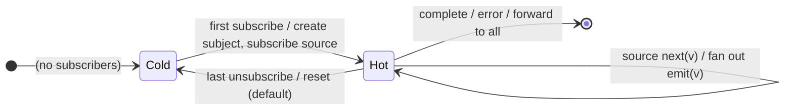

# `share` as a Mealy Machine

> `share(config?)` is the modern all-in-one **ref-counted multicast**: it inserts
> a `Subject` between the source and its subscribers so **one** source
> subscription feeds **many** consumers, going hot on the first subscriber and
> (by default) resetting when the ref-count hits zero. It is the shared
> Cold⇄Hot multicast skeleton with configurable reset policies.

Signature:

```ts
share<T>(options?: ShareConfig<T>)
```

---

## 1. The 6-Tuple  M = (Q, Σ, Λ, δ, λ, q₀)

### Q — States

- `Cold` — no subscribers; the source is not running.
- `Hot(refCount, subject)` — the source is subscribed once; `refCount`
  consumers are attached.
- `Done` — terminal (subject to the reset policy).

### Σ — Input alphabet

- `next(v)`, `complete`, `error(e)` (from the source), plus `subscribe` /
  `unsubscribe` meta-events (ref-count changes).

### Λ — Output alphabet

- `emit(v)` fanned out to all subscribers; `complete`, `error(e)`, `noop`.

### δ, λ

The first subscriber creates the Subject and subscribes the source (`Cold →
Hot`). Each source `next` fans out to all. The last unsubscribe may reset back
to `Cold` (default). A plain `Subject` means **late subscribers see only values
emitted after they join**.

### q₀ — Initial state

`q₀ = Cold`.

---

## 2. State Transition Table (STT)

| # | State       | Input             | Next / Output                               |
|---|-------------|-------------------|---------------------------------------------|
| 1 | `Cold`      | first `subscribe` | create subject; subscribe source; `Hot(1)`  |
| 2 | `Hot(n)`    | `subscribe`       | `Hot(n+1)` (plain Subject: no replay)       |
| 3 | `Hot(n)`    | source `next(v)`  | subject.next(v) → `emit(v)` to all          |
| 4 | `Hot(n)`    | `unsubscribe`     | `Hot(n-1)`; if `n-1 = 0`, reset per config  |
| 5 | `Hot(n)`    | `complete`/`error`| forward to all; terminal per reset policy   |

---

## 3. State Transition Diagram (STD)



---

## 4. From STT rows to test cases

- **Rows 2-3** — one shared source run; a late subscriber sees only values
  emitted after it joins (verified with two observers at different frames).

See [`tests/77a-share.test.ts`](../../tests/77a-share.test.ts).

---

## Relationship to the family

`share` is the modern ref-counted multicast; [`shareReplay`](shareReplay.md) =
`share({ connector: () => new ReplaySubject(...) })`. The classic plumbing is
[`multicast`](multicast.md) + [`refCount`](refCount.md). See
[`16-error-repeat-multicast-family.md`](../16-error-repeat-multicast-family.md).
