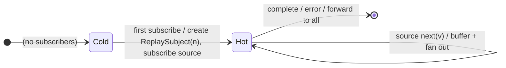

# `shareReplay` as a Mealy Machine

> `shareReplay(bufferSize?)` is [`share`](share.md) backed by a `ReplaySubject`:
> a ref-counted multicast whose **late subscribers replay the last `n`
> values**. It is `share({ connector: () => new ReplaySubject(bufferSize, ...) })`.

Signature:

```ts
shareReplay<T>(configOrBufferSize?: number | ShareReplayConfig, windowTime?, scheduler?)
```

---

## 1. The 6-Tuple  M = (Q, Σ, Λ, δ, λ, q₀)

Same Cold⇄Hot multicast skeleton as [`share`](share.md), with the Subject fixed
to a `ReplaySubject(n)`:

### Q — States

- `Cold`, `Hot(refCount, replaySubject)`, `Done`.

### δ, λ

The first subscriber connects the source via a `ReplaySubject(n)`. Each source
`next` is buffered (up to `n`) and fanned out. A **new** subscriber immediately
receives the buffered last `n` values, then live values.

### q₀ — Initial state

`q₀ = Cold`.

---

## 2. State Transition Table (STT)

| # | State    | Input             | Next / Output                                   |
|---|----------|-------------------|-------------------------------------------------|
| 1 | `Cold`   | first `subscribe` | create ReplaySubject(n); subscribe source; `Hot(1)` |
| 2 | `Hot(m)` | `subscribe`       | `Hot(m+1)`; **replay last n** to the newcomer   |
| 3 | `Hot(m)` | source `next(v)`  | buffer (cap n); `emit(v)` to all                |
| 4 | `Hot(m)` | `complete`/`error`| forward to all                                  |

Row 2 is the difference from plain `share`: the newcomer gets the replay buffer.

---

## 3. State Transition Diagram (STD)



---

## 4. From STT rows to test cases

- **Row 2** — a late subscriber replays the last `n` values synchronously, then
  receives live values.

See [`tests/77b-shareReplay.test.ts`](../../tests/77b-shareReplay.test.ts).

---

## Relationship to the family

`shareReplay(n)` = [`share`](share.md) with a `ReplaySubject(n)` connector — the
replay analogue of [`publishReplay`](publishReplay.md) + `refCount`. See
[`16-error-repeat-multicast-family.md`](../16-error-repeat-multicast-family.md).
