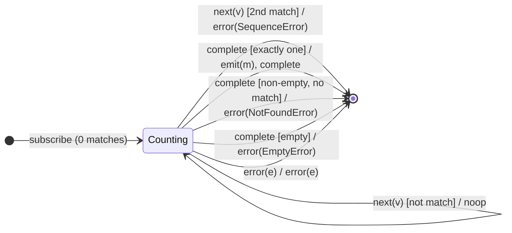

# `single` as a Mealy Machine

> `single(predicate?)` asserts that **exactly one** value (optionally matching a
> predicate) exists, and emits it on completion. It is the richest existence
> machine in the family — **four distinct outcomes** decided by a match counter:
> exactly-one (success), more-than-one (`SequenceError`, early), none-in-a-
> non-empty-source (`NotFoundError`), and empty (`EmptyError`).

Signature:

```ts
single<T>(predicate?: (value: T, index: number, source: Observable<T>) => boolean)
```

---

## 1. The 6-Tuple  M = (Q, Σ, Λ, δ, λ, q₀)

### Q — States

- `Counting(matches, lastMatch?, seenAny)` — number of matches so far, the
  remembered match, and whether any source value has been seen at all.
- `Done` — terminal.

### Σ — Input alphabet

- `next(v)`, `complete`, `error(e)`.

### Λ — Output alphabet

- `emit(x)`, `complete`, `error(SequenceError | NotFoundError | EmptyError)`,
  `noop`.

### δ, λ

Matches are counted. The **second** match errors immediately with
`SequenceError`. On `complete`, the outcome depends on the match count and
whether the source was empty.

### q₀ — Initial state

`q₀ = Counting(0, ∅, false)`.

---

## 2. State Transition Table (STT)

| # | State                   | Input (Σ)  | Guard                      | Next state           | Output (λ)                  |
|---|-------------------------|------------|----------------------------|----------------------|-----------------------------|
| 1 | `Counting(0, ∅, _)`     | `next(v)`  | matches `p`                | `Counting(1, v, …)`  | `noop`                      |
| 2 | `Counting(1, m, _)`     | `next(v)`  | matches `p` (2nd!)         | `Done`               | `error(SequenceError)`      |
| 3 | `Counting(c, m, _)`     | `next(v)`  | not a match                | `Counting(c, m, true)`| `noop`                     |
| 4 | `Counting(1, m, _)`     | `complete` | exactly one match          | `Done`               | `emit(m)`, `complete`       |
| 5 | `Counting(0, ∅, true)`  | `complete` | none, but source non-empty | `Done`               | `error(NotFoundError)`      |
| 6 | `Counting(0, ∅, false)` | `complete` | source empty               | `Done`               | `error(EmptyError)`         |
| 7 | any                     | `error(e)` | —                          | `Done`               | `error(e)`                  |

Row 2 is the "too many" short-circuit, fired on the *second* match (not
deferred to completion).

---

## 3. State Transition Diagram (STD)



---

## 4. From STT rows to test cases

- **Row 4** — exactly one value/match → emits it on completion.
- **Row 2** — a second match → `SequenceError` immediately.
- **Row 5** — non-empty source with no match → `NotFoundError`.
- **Row 6** — empty source → `EmptyError`.

See [`tests/32-single.test.ts`](../../tests/32-single.test.ts).

---

## Relationship to the family

`single` is the four-outcome existence machine: a strict counter whose output
distinguishes three error cases plus success. Contrast with
[`first`](first.md)/[`last`](last.md), which accept any count ≥ 1. See
[`10-filtering-family.md`](../10-filtering-family.md).
