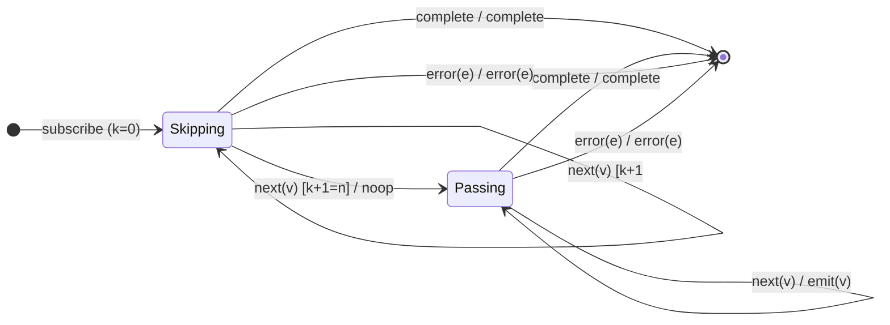

# `skip` as a Mealy Machine

> `skip(n)` discards the first `n` source values, then passes everything through.
> It is [`take`](take.md)'s dual: `take` counts emissions then stops; `skip`
> counts suppressions then starts. Unlike `take`, `skip` does **not**
> self-complete — it runs to the source's own completion.

Signature:

```ts
skip<T>(count: number)
```

---

## 1. The 6-Tuple  M = (Q, Σ, Λ, δ, λ, q₀)

### Q — States

- `Skipping(k)` for `0 ≤ k < n` — `k` values discarded so far.
- `Passing` — latched open; all further values pass.
- `Done` — terminal.

### Σ — Input alphabet

- `next(v)`, `complete`, `error(e)`.

### Λ — Output alphabet

- `emit(v)`, `complete`, `error(e)`, `noop`.

### δ, λ

The first `n` values are counted and dropped; once `n` have been skipped the
machine latches to `Passing` and emits every subsequent value.

### q₀ — Initial state

`q₀ = Skipping(0)` — or `Passing` immediately if `n ≤ 0`.

---

## 2. State Transition Table (STT)

| # | State         | Input (Σ)  | Guard     | Next state      | Output (λ) |
|---|---------------|------------|-----------|-----------------|------------|
| 1 | `Skipping(k)` | `next(v)`  | `k+1 < n` | `Skipping(k+1)` | `noop`     |
| 2 | `Skipping(k)` | `next(v)`  | `k+1 = n` | `Passing`       | `noop`     |
| 3 | `Passing`     | `next(v)`  | —         | `Passing`       | `emit(v)`  |
| 4 | any           | `complete` | —         | `Done`          | `complete` |
| 5 | any           | `error(e)` | —         | `Done`          | `error(e)` |

Row 2 is the latch edge (last skipped value); Row 3 is the pass-through loop.

---

## 3. State Transition Diagram (STD)



---

## 4. From STT rows to test cases

- **Rows 1/2** — first `n` values suppressed.
- **Row 3** — subsequent values pass through.
- **Boundary** — `skip(0)` passes everything; `skip(n ≥ length)` emits nothing
  but still completes normally.

See [`tests/25-skip.test.ts`](../../tests/25-skip.test.ts).

---

## Relationship to the family

`skip` counts suppressions then starts — the mirror of [`take`](take.md). Its
predicate analogue is [`skipWhile`](skipWhile.md). See
[`10-filtering-family.md`](../10-filtering-family.md).
