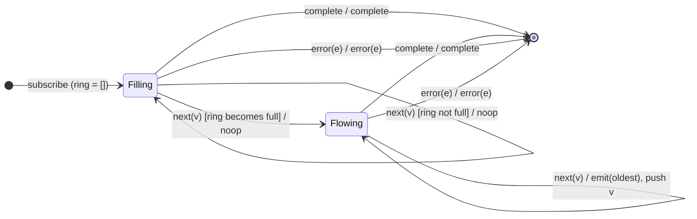

# `skipLast` as a Mealy Machine

> `skipLast(n)` emits everything **except the final `n`** values. It works as a
> delay line: when value `v[i]` arrives it emits `v[i−n]`, so the last `n` values
> never get their turn before completion.

Signature:

```ts
skipLast<T>(skipCount: number)
```

---

## 1. The 6-Tuple  M = (Q, Σ, Λ, δ, λ, q₀)

### Q — States

- `Filling(ring)` — ring buffer still priming (`|ring| < n`).
- `Flowing(ring)` — ring full (`|ring| = n`); each new value releases the oldest.
- `Done` — terminal.

### Σ — Input alphabet

- `next(v)`, `complete`, `error(e)`.

### Λ — Output alphabet

- `emit(x)`, `complete`, `error(e)`, `noop`.

### δ, λ

The first `n` values only prime the ring (`noop`). Once full, each `next(v)`
emits the oldest buffered value and pushes `v`. On completion the `n` values
still in the ring are dropped.

### q₀ — Initial state

`q₀ = Filling([])` — or effectively a pass-through if `n ≤ 0`.

---

## 2. State Transition Table (STT)

| # | State           | Input (Σ)  | Guard        | Next state                  | Output (λ)                       |
|---|-----------------|------------|--------------|-----------------------------|----------------------------------|
| 1 | `Filling(ring)` | `next(v)`  | `\|ring\| < n`| `Filling(ring ++ [v])`      | `noop` (priming)                 |
| 2 | `Flowing(ring)` | `next(v)`  | `\|ring\| = n`| `Flowing(ring[1:] ++ [v])`  | `emit(ring[0])`                  |
| 3 | any             | `complete` | —            | `Done`                      | `complete` (drop the n still held)|
| 4 | any             | `error(e)` | —            | `Done`                      | `error(e)`                       |

---

## 3. State Transition Diagram (STD)



---

## 4. From STT rows to test cases

- **Row 1** — first `n` values are withheld (priming).
- **Row 2** — subsequent values release the delayed oldest value.
- **Row 3** — on completion the trailing `n` are dropped.

See [`tests/26-skipLast.test.ts`](../../tests/26-skipLast.test.ts).

---

## Relationship to the family

`skipLast` is the delay-line dual of [`takeLast`](takeLast.md): `takeLast`
*keeps* the final `n`, `skipLast` *drops* them. See
[`10-filtering-family.md`](../10-filtering-family.md).
