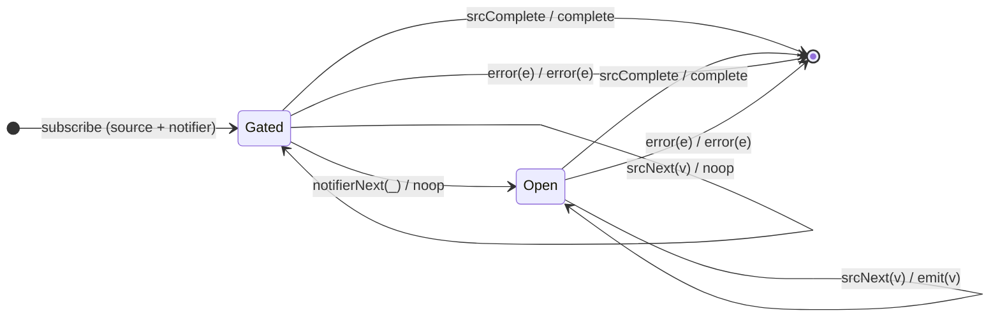

# `skipUntil` as a Mealy Machine

> `skipUntil(notifier)` discards source values until the **notifier emits**, then
> passes the rest through. It is the mirror of [`takeUntil`](takeUntil.md):
> `takeUntil` gates the *end*, `skipUntil` gates the *start*. Two input
> alphabets (source + notifier).

Signature:

```ts
skipUntil<T>(notifier: ObservableInput<any>)
```

---

## 1. The 6-Tuple  M = (Q, Σ, Λ, δ, λ, q₀)

### Q — States

- `Gated` — notifier hasn't fired; dropping source values.
- `Open` — notifier has fired; passing source values.
- `Done` — terminal.

### Σ — Input alphabet

- Source: `srcNext(v)`, `srcComplete`, `srcError(e)`.
- Notifier: `notifierNext(_)`, `notifierError(e)`.

### Λ — Output alphabet

- `emit(v)`, `complete`, `error(e)`, `noop`.

### δ, λ

While `Gated`, source values are dropped. The **first** notifier emission opens
the gate; thereafter source values pass through.

### q₀ — Initial state

`q₀ = Gated`.

---

## 2. State Transition Table (STT)

| # | State   | Input (Σ)          | Next state | Output (λ) |
|---|---------|--------------------|------------|------------|
| 1 | `Gated` | `srcNext(v)`       | `Gated`    | `noop`     |
| 2 | `Gated` | `notifierNext(_)`  | `Open`     | `noop`     |
| 3 | `Open`  | `srcNext(v)`       | `Open`     | `emit(v)`  |
| 4 | any     | `srcComplete`      | `Done`     | `complete` |
| 5 | any     | `*Error(e)`        | `Done`     | `error(e)` |

Row 2 is the gate-open edge; the notifier value itself is not forwarded.

---

## 3. State Transition Diagram (STD)



---

## 4. From STT rows to test cases

- **Row 1** — source values before the notifier fires are dropped.
- **Row 2 + 3** — once the notifier emits, subsequent source values pass.
- **Row 4** — source completing while still gated yields a completed (empty)
  output.

See [`tests/28-skipUntil.test.ts`](../../tests/28-skipUntil.test.ts).

---

## Relationship to the family

`skipUntil` is the notifier-driven start gate; its mirror
[`takeUntil`](takeUntil.md) is the end cutoff. Both add a second input alphabet.
See [`10-filtering-family.md`](../10-filtering-family.md).
