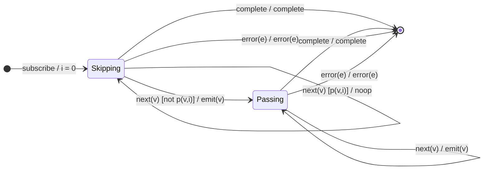

# `skipWhile` as a Mealy Machine

> `skipWhile(predicate)` discards values while `predicate(v, i)` holds; once the
> predicate fails **once**, it passes everything (including that value) onward
> and never consults the predicate again. The latch is a one-way
> `Skipping → Passing`.

Signature:

```ts
skipWhile<T>(predicate: (value: T, index: number) => boolean)
```

---

## 1. The 6-Tuple  M = (Q, Σ, Λ, δ, λ, q₀)

### Q — States

- `Skipping` — predicate still holding; dropping values.
- `Passing` — latched open; emitting everything.
- `Done` — terminal.

### Σ — Input alphabet

- `next(v)`, `complete`, `error(e)`.

### Λ — Output alphabet

- `emit(v)`, `complete`, `error(e)`, `noop`.

### δ, λ

While `predicate(v, i)` is truthy, drop and stay `Skipping`. The first falsy
value is **emitted** and latches to `Passing`; thereafter everything passes.

### q₀ — Initial state

`q₀ = Skipping`, index `i = 0`.

---

## 2. State Transition Table (STT)

| # | State      | Input (Σ)  | Guard          | Next state | Output (λ) |
|---|------------|------------|----------------|------------|------------|
| 1 | `Skipping` | `next(v)`  | `p(v,i)=true`  | `Skipping` | `noop`     |
| 2 | `Skipping` | `next(v)`  | `p(v,i)=false` | `Passing`  | `emit(v)`  |
| 3 | `Passing`  | `next(v)`  | —              | `Passing`  | `emit(v)`  |
| 4 | any        | `complete` | —              | `Done`     | `complete` |
| 5 | any        | `error(e)` | —              | `Done`     | `error(e)` |

Row 2 is the latch edge — note it **emits** the value that broke the predicate.

---

## 3. State Transition Diagram (STD)



---

## 4. From STT rows to test cases

- **Row 1** — values dropped while the predicate holds.
- **Row 2** — the first failing value is emitted and the gate latches open.
- **Row 3** — all subsequent values pass, even if they would satisfy the
  original predicate.

See [`tests/27-skipWhile.test.ts`](../../tests/27-skipWhile.test.ts).

---

## Relationship to the family

`skipWhile`'s one-way latch is the predicate analogue of [`skip`](skip.md)'s
counter latch, and the mirror of [`takeWhile`](takeWhile.md). See
[`10-filtering-family.md`](../10-filtering-family.md).
