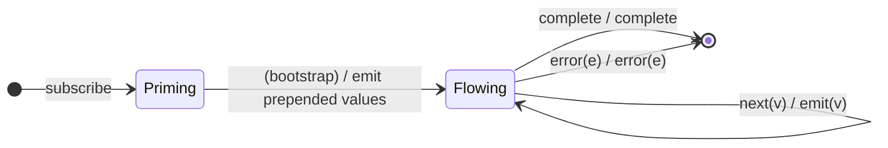

# `startWith` as a Mealy Machine

> `startWith(...values)` emits the given values immediately **on subscription**,
> before anything from the source, then behaves as identity. The extra values
> are produced on the *subscribe* edge — the mirror of
> [`endWith`](endWith.md), which adds them on the *complete* edge.

Signature:

```ts
startWith<T>(...values: T[])
```

---

## 1. The 6-Tuple  M = (Q, Σ, Λ, δ, λ, q₀)

### Q — States

- `Priming` — before the prepended values are emitted.
- `Flowing` — passing the source through unchanged.
- `Done` — terminal.

### Σ — Input alphabet

- `subscribe` (the bootstrap edge), `next(v)`, `complete`, `error(e)`.

### Λ — Output alphabet

- `emit(x)`, `complete`, `error(e)`, `noop`.

### δ, λ

On subscribe, synchronously emit all prepended values and move to `Flowing`.
Thereafter the machine is the identity on the source. The prepended emissions do
**not** time-shift the source — it keeps its own frames.

### q₀ — Initial state

`q₀ = Priming`.

---

## 2. State Transition Table (STT)

| # | State      | Input       | Next      | Output (λ)                                  |
|---|------------|-------------|-----------|---------------------------------------------|
| 0 | `Priming`  | `subscribe` | `Flowing` | `emit(v0) … emit(vk)` (the prepended values)|
| 1 | `Flowing`  | `next(v)`   | `Flowing` | `emit(v)` (identity)                        |
| 2 | `Flowing`  | `complete`  | `Done`    | `complete`                                  |
| 3 | `Flowing`  | `error(e)`  | `Done`    | `error(e)`                                  |

---

## 3. State Transition Diagram (STD)



---

## 4. From STT rows to test cases

- **Row 0** — prepended values appear first, synchronously at the subscribe
  frame (a multi-value prepend is a synchronous group `(xy)` at frame 0).
- **Row 1** — source values follow, on their own frames (no time-shift).
- **Row 2** — completion forwarded.

See [`tests/47-startWith.test.ts`](../../tests/47-startWith.test.ts).

---

## Relationship to the family

`startWith` prepends on subscribe; [`endWith`](endWith.md) appends on complete —
a clean prepend/append pair. See
[`11-aggregation-family.md`](../11-aggregation-family.md).
