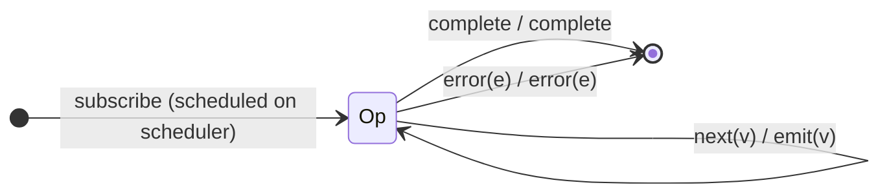

# `subscribeOn` as a Mealy Machine

> `subscribeOn(scheduler)` schedules the **subscription** itself onto
> `scheduler` (delaying *when* the source is subscribed). As a *value* machine it
> is the **identity** — every value and terminal passes through unchanged; only
> the subscription timing is affected.

Signature:

```ts
subscribeOn<T>(scheduler: SchedulerLike, delay = 0)
```

---

## 1. The 6-Tuple  M = (Q, Σ, Λ, δ, λ, q₀)

### Q — States

- `Op` — single operational state.
- `Done` — terminal.

### Σ — Input alphabet

- `next(v)`, `complete`, `error(e)`.

### Λ — Output alphabet

- `emit(v)`, `complete`, `error(e)`.

### δ, λ

Identity on values and terminals. The only effect is that `subscribe` is queued
on `scheduler` (which may delay when the source starts; inside
`TestScheduler.run()` with `asyncScheduler` it adds no virtual-time delay).

### q₀ — Initial state

`q₀ = Op`.

---

## 2. State Transition Table (STT)

| # | State | Input (Σ)  | Next  | Output (λ) |
|---|-------|------------|-------|------------|
| 1 | `Op`  | `next(v)`  | `Op`  | `emit(v)`  |
| 2 | `Op`  | `complete` | `Done`| `complete` |
| 3 | `Op`  | `error(e)` | `Done`| `error(e)` |

(The subscription edge is scheduled onto `scheduler` at subscribe time.)

---

## 3. State Transition Diagram (STD)



---

## 4. From STT rows to test cases

- **Row 1** — values are identical; the subscription is scheduled (no
  virtual-time delay under `TestScheduler.run()`).

See [`tests/67b-subscribeOn.test.ts`](../../tests/67b-subscribeOn.test.ts).

---

## Relationship to the family

`subscribeOn` schedules the *subscription*; [`observeOn`](observeOn.md)
re-schedules *outgoing* notifications. Both are identity value machines. See
[`14-time-family.md`](../14-time-family.md).
