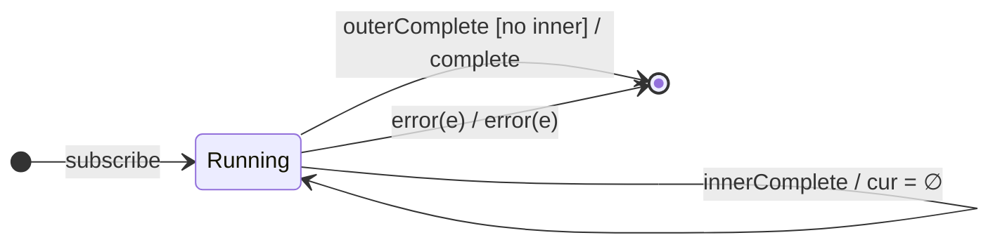

# `switchAll` as a Mealy Machine

> `switchAll()` flattens a higher-order Observable keeping **only the latest**
> inner: each new inner from the source cancels the previous one. It is
> `switchMap(identity)` — the **switch policy** with identity projection.

Signature:

```ts
switchAll<T>()
```

---

## 1. The 6-Tuple  M = (Q, Σ, Λ, δ, λ, q₀)

Identical skeleton to [`switchMap`](switchMap.md) with `project = identity`.

### Q — States

- `Running(cur?, outerDone)`, `Done`.

### δ, λ

Each `outerNext(inner)` unsubscribes `cur` and subscribes `inner` as the new
`cur`. Inner values forward. `q₀ = Running(∅, false)`.

---

## 2. State Transition Table (STT)

| # | State             | Input               | Next / Output                              |
|---|-------------------|---------------------|--------------------------------------------|
| U1| `Running(c,_)`    | `innerNext(x)`      | `emit(x)`                                  |
| S1| `Running(cur?,_)` | `outerNext(inner)`  | unsubscribe `cur`; subscribe `inner`; `noop`|
| S2| `Running(cur,_)`  | `innerComplete`     | `cur := ∅`; `noop`                         |
| U4| `Running(∅,true)` | (inner done)        | outer done → `complete`                    |
| U2/U3| `Running(c,_)` | inner/outer error   | `error(e)` → `Done`                        |

---

## 3. State Transition Diagram (STD)



---

## 4. From STT rows to test cases

- **S1** — a new inner cancels the previous; the earlier inner's later values
  never appear.

See [`tests/53c-switchAll.test.ts`](../../tests/53c-switchAll.test.ts).

---

## Relationship to the family

`switchAll()` = [`switchMap`](switchMap.md)`(identity)`. See
[`12-flattening-family.md`](../12-flattening-family.md).
