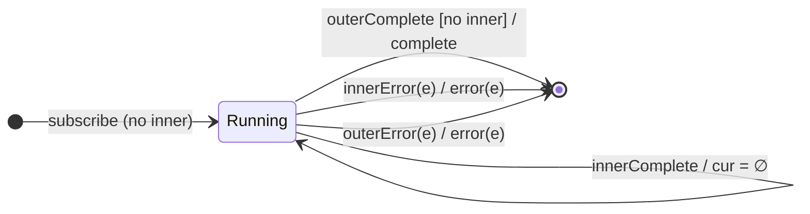

# `switchMap` as a Mealy Machine

> `switchMap(project)` maps each source value to an inner Observable, but keeps
> **only the latest** inner: a new source value **unsubscribes the previous
> inner** before subscribing the new one. The **switch policy** = *cancel the
> old*. Ideal for type-ahead search.

Signature:

```ts
switchMap<T, R>(project: (value: T, index: number) => ObservableInput<R>)
```

---

## 1. The 6-Tuple  M = (Q, Σ, Λ, δ, λ, q₀)

### Q — States

- `Running(cur?, outerDone)` — a single current inner `cur` (or ∅) and whether
  the outer completed.
- `Done` — terminal.

### Σ — Input alphabet

- Outer: `outerNext(v)`, `outerComplete`, `outerError(e)`.
- Inner: `innerNext(x)`, `innerComplete`, `innerError(e)`.

### Λ — Output alphabet

- `emit(x)`, `complete`, `error(e)`, `noop`.

### δ, λ

Inner values forward. A source value cancels the in-flight inner (dropping its
pending/future values) and subscribes a fresh one. Output completes when the
outer is done and the current inner has completed.

### q₀ — Initial state

`q₀ = Running(∅, false)`.

---

## 2. State Transition Table (STT)

| # | State               | Input           | Guard                   | Next state / Output                               |
|---|---------------------|-----------------|-------------------------|---------------------------------------------------|
| U1| `Running(c,_)`      | `innerNext(x)`  | —                       | `emit(x)`                                         |
| S1| `Running(cur?,_)`   | `outerNext(v)`  | —                       | unsubscribe `cur`; subscribe `project(v)` as `cur`; `noop` |
| S2| `Running(cur,_)`    | `innerComplete` | —                       | `cur := ∅`; `noop`                                |
| U4| `Running(∅,true)`   | (inner done)    | outer done, no inner    | `complete`                                        |
| U2| `Running(c,_)`      | `innerError(e)` | —                       | `error(e)` → `Done`                               |
| U3| `Running(c,_)`      | `outerError(e)` | —                       | `error(e)` → `Done`                               |

S1 is the switch edge: the previous inner is discarded, so its later values
never reach the output.

---

## 3. State Transition Diagram (STD)



---

## 4. From STT rows to test cases

- **S1** — a second source value cancels the first inner; only the latest
  inner's values appear.
- **U4** — if the outer completes while an inner is running, output waits for
  that inner.

See [`tests/51-switchMap.test.ts`](../../tests/51-switchMap.test.ts).

---

## Relationship to the family

[`switchAll`](switchAll.md) is `switchMap(identity)`;
[`switchMapTo`](switchMapTo.md) is `switchMap(() => inner)`. The switch policy
*cancels the old*, the dual of [`exhaustMap`](exhaustMap.md) (which drops the
new). See [`12-flattening-family.md`](../12-flattening-family.md).
