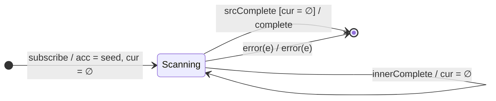

# `switchScan` as a Mealy Machine

> `switchScan(accumulator, seed)` is the **switch**-flavoured higher-order
> `scan`: like [`mergeScan`](mergeScan.md) with concurrency 1, but a new source
> value **unsubscribes the previous inner** before subscribing the new one. The
> state carries the accumulator **and** a single, replaceable inner
> subscription.

Signature:

```ts
switchScan<V, A>(
  accumulator: (acc: A, value: V, index: number) => ObservableInput<A>,
  seed: A
)
```

---

## 1. The 6-Tuple  M = (Q, Σ, Λ, δ, λ, q₀)

### Q — States

- `Scanning(acc, cur?)` — accumulator `acc` and an optional current inner
  subscription `cur` (at most one).
- `Done` — terminal.

### Σ — Input alphabet

- Source: `next(v)`, `complete`, `error(e)`.
- Inner: `innerNext(r)`, `innerComplete`, `innerError(e)`.

### Λ — Output alphabet

- `emit(r)`, `complete`, `error(e)`, `noop`.

### δ, λ

A source `next(v)` **cancels** `cur` (if any), computes a new inner from
`accumulator(acc, v, i)`, and subscribes it. Each `innerNext(r)` updates the
accumulator to `r` and emits `r`. Because only the latest inner survives,
earlier in-flight inners are cut off.

### q₀ — Initial state

`q₀ = Scanning(seed, ∅)`.

---

## 2. State Transition Table (STT)

| # | Current state       | Input           | Guard             | Next state                             | Output (λ) |
|---|---------------------|-----------------|-------------------|----------------------------------------|------------|
| 1 | `Scanning(s, cur?)` | `next(v)`       | —                 | cancel `cur`; subscribe `acc(s,v)` → `cur'` | `noop` |
| 2 | `Scanning(s, cur)`  | `innerNext(r)`  | —                 | `Scanning(r, cur)`                     | `emit(r)`  |
| 3 | `Scanning(s, cur)`  | `innerComplete` | —                 | `Scanning(s, ∅)`                       | `noop`     |
| 4 | `Scanning(s, ∅)`    | `srcComplete`   | no active inner   | `Done`                                 | `complete` |
| 5 | `Scanning(s, cur)`  | `srcComplete`   | inner still active| wait (stay)                            | `noop`     |
| 6 | any                 | `error(e)`      | source or inner   | `Done`                                 | `error(e)` |

Row 1 is the switch edge: the previous inner is discarded before the new one
starts, so values from a superseded inner never reach the output.

---

## 3. State Transition Diagram (STD)



---

## 4. From STT rows to test cases

- **Row 1 + 2** — a later source value cancels the earlier inner; only the
  latest inner's emissions appear.
- **Row 4** — completes once source is done and no inner is active.
- **Row 6** — error propagates.

See [`tests/17-switchScan.test.ts`](../../tests/17-switchScan.test.ts).

---

## Relationship to the family

`switchScan` : `mergeScan` :: `switchMap` : `mergeMap` — same accumulator state,
different inner-subscription policy (cancel-previous vs. run-all). See
[`09-transformation-family.md`](../09-transformation-family.md) and Session 6.
