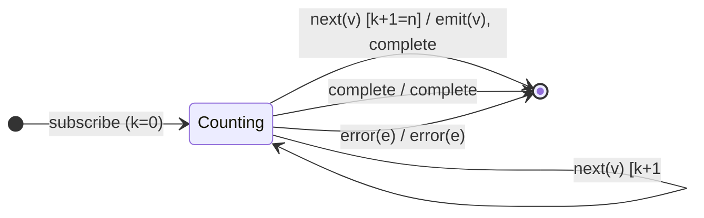

# `take` as a Mealy Machine

> `take(n)` emits the first `n` source values, then **self-completes** (and
> unsubscribes upstream). It is the canonical **counting FSM** of the filtering
> family. `n ≤ 0` emits nothing and completes immediately.

Signature:

```ts
take<T>(count: number)
```

---

## 1. The 6-Tuple  M = (Q, Σ, Λ, δ, λ, q₀)

### Q — States

- `Counting(k)` for `0 ≤ k < n` — `k` values emitted so far.
- `Done` — terminal.

### Σ — Input alphabet

- `next(v)`, `complete`, `error(e)`.

### Λ — Output alphabet

- `emit(v)`, `complete`, `error(e)`, `noop`.

### δ, λ

Each `next(v)` emits `v` and increments the counter. On the **n-th** value the
machine emits **and** completes in the same step.

### q₀ — Initial state

`q₀ = Counting(0)` — or `Done` immediately if `n ≤ 0`.

---

## 2. State Transition Table (STT)

| # | Current state | Input (Σ)  | Guard     | Next state      | Output (λ)                       |
|---|---------------|------------|-----------|-----------------|----------------------------------|
| 1 | `Counting(k)` | `next(v)`  | `k+1 < n` | `Counting(k+1)` | `emit(v)`                        |
| 2 | `Counting(k)` | `next(v)`  | `k+1 = n` | `Done`          | `emit(v)`, `complete` (self-complete) |
| 3 | `Counting(k)` | `complete` | —         | `Done`          | `complete`                       |
| 4 | `Counting(k)` | `error(e)` | —         | `Done`          | `error(e)`                       |

Row 2 is the defining edge: the n-th value triggers emit-and-complete on the
**same frame**, and upstream is torn down.

---

## 3. State Transition Diagram (STD)



---

## 4. From STT rows to test cases

- **Row 1 + 2** — first `n` values emitted; output completes on the n-th frame.
- **Row 3** — source completes before `n` reached → forward completion early.
- **Boundary** — `take(0)` emits nothing and completes immediately.

See [`tests/21-take.test.ts`](../../tests/21-take.test.ts).

---

## Relationship to the family

`take(n)` is the counting template; [`skip`](skip.md) is its dual (count
suppressions, then start). The self-complete-on-the-nth-frame timing contrasts
with [`takeWhile`](takeWhile.md), which can only stop one notification *after*
the last emitted value. See
[`10-filtering-family.md`](../10-filtering-family.md).
