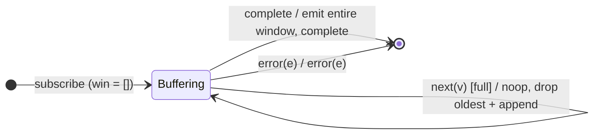

# `takeLast` as a Mealy Machine

> `takeLast(n)` keeps a sliding window of the **last `n`** source values and
> emits them, in order, **on completion**. It cannot emit anything earlier — it
> can't know which values are "last" until the source completes.
> `takeLast(0)` ⇒ `EMPTY`.

Signature:

```ts
takeLast<T>(count: number)
```

---

## 1. The 6-Tuple  M = (Q, Σ, Λ, δ, λ, q₀)

### Q — States

- `Buffering(win)` — FIFO window `win` of at most `n` values.
- `Done` — terminal.

### Σ — Input alphabet

- `next(v)`, `complete`, `error(e)`.

### Λ — Output alphabet

- `emit(x)`, `complete`, `error(e)`, `noop`.

### δ, λ

Each `next(v)` appends to the window, dropping the oldest once the window is
full — always `noop` on output. On `complete` the whole window is flushed in
arrival order, then completion. On `error` the window is discarded.

### q₀ — Initial state

`q₀ = Buffering([])` — or `Done` immediately if `n ≤ 0`.

---

## 2. State Transition Table (STT)

| # | Current state    | Input (Σ)  | Guard        | Next state                 | Output (λ)                                   |
|---|------------------|------------|--------------|----------------------------|----------------------------------------------|
| 1 | `Buffering(win)` | `next(v)`  | `\|win\| < n`| `Buffering(win ++ [v])`    | `noop`                                       |
| 2 | `Buffering(win)` | `next(v)`  | `\|win\| = n`| `Buffering(win[1:] ++ [v])`| `noop` (drop oldest)                         |
| 3 | `Buffering(win)` | `complete` | —            | `Done`                     | `emit(win[0]) … emit(win[last])`, `complete` |
| 4 | `Buffering(win)` | `error(e)` | —            | `Done`                     | `error(e)` (window dropped)                  |

Row 3 flushes the whole window synchronously at the completion frame.

---

## 3. State Transition Diagram (STD)



---

## 4. From STT rows to test cases

- **Rows 1/2** — nothing emitted while the source runs.
- **Row 3** — on completion, the last `n` values emit in order, then complete.
- **Boundary** — `takeLast(n)` with a source shorter than `n` emits everything;
  `takeLast(0)` emits nothing.

See [`tests/22-takeLast.test.ts`](../../tests/22-takeLast.test.ts).

---

## Relationship to the family

`takeLast` is an emit-on-complete buffer, contrasting with [`take`](take.md)'s
emit-as-you-go prefix. `takeLast(1)` is the engine behind [`last`](last.md). See
[`10-filtering-family.md`](../10-filtering-family.md).
