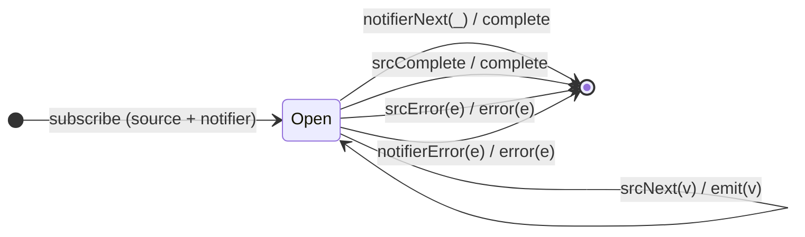

# `takeUntil` as a Mealy Machine

> `takeUntil(notifier)` passes source values through until the **notifier
> emits**, then completes. It reintroduces a **second input alphabet** (the
> notifier stream), like Session 2's `withLatestFrom`.

Signature:

```ts
takeUntil<T>(notifier: ObservableInput<any>)
```

---

## 1. The 6-Tuple  M = (Q, Σ, Λ, δ, λ, q₀)

### Q — States

- `Open` — forwarding the source.
- `Done` — terminal.

### Σ — Input alphabet (two sources)

- Source: `srcNext(v)`, `srcComplete`, `srcError(e)`.
- Notifier: `notifierNext(_)`, `notifierError(e)`. A notifier that only
  **completes** without emitting does **not** cut off the source.

### Λ — Output alphabet

- `emit(v)`, `complete`, `error(e)`, `noop`.

### δ, λ

Source values pass through. The **first** `notifierNext` completes the output
immediately, regardless of source progress.

### q₀ — Initial state

`q₀ = Open`.

---

## 2. State Transition Table (STT)

| # | State  | Input (Σ)          | Next   | Output (λ) |
|---|--------|--------------------|--------|------------|
| 1 | `Open` | `srcNext(v)`       | `Open` | `emit(v)`  |
| 2 | `Open` | `notifierNext(_)`  | `Done` | `complete` |
| 3 | `Open` | `srcComplete`      | `Done` | `complete` |
| 4 | `Open` | `srcError(e)`      | `Done` | `error(e)` |
| 5 | `Open` | `notifierError(e)` | `Done` | `error(e)` |

Row 2 is the cutoff: the first notifier value completes the output.

---

## 3. State Transition Diagram (STD)



---

## 4. From STT rows to test cases

- **Row 1** — source values pass through before the notifier fires.
- **Row 2** — the notifier's first emission completes the output; later source
  values are dropped.
- **Row 3** — source completes on its own before the notifier → normal
  completion.

See [`tests/24-takeUntil.test.ts`](../../tests/24-takeUntil.test.ts).

---

## Relationship to the family

`takeUntil` is the notifier-driven cutoff; its mirror [`skipUntil`](skipUntil.md)
gates the *start* instead of the end. See
[`10-filtering-family.md`](../10-filtering-family.md).
