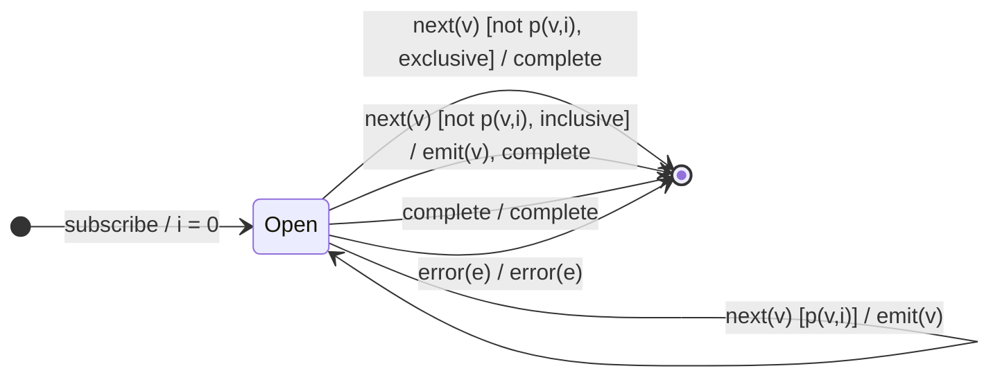

# `takeWhile` as a Mealy Machine

> `takeWhile(predicate, inclusive?)` emits values while `predicate(v, i)` holds;
> on the first value that fails, it completes. With `inclusive = true` it also
> emits that first failing value before completing.

Signature:

```ts
takeWhile<T>(predicate: (value: T, index: number) => boolean, inclusive = false)
```

---

## 1. The 6-Tuple  M = (Q, Σ, Λ, δ, λ, q₀)

### Q — States

- `Open` — still emitting.
- `Done` — terminal.

### Σ — Input alphabet

- `next(v)`, `complete`, `error(e)`.

### Λ — Output alphabet

- `emit(v)`, `complete`, `error(e)`, `noop`.

### δ, λ

While `predicate(v, i)` is truthy, emit `v` and stay `Open`. On the first falsy
value: complete (exclusive), or emit-then-complete (inclusive).

### q₀ — Initial state

`q₀ = Open`, index `i = 0`.

---

## 2. State Transition Table (STT)

| # | State  | Input (Σ)  | Guard                            | Next   | Output (λ)             |
|---|--------|------------|----------------------------------|--------|------------------------|
| 1 | `Open` | `next(v)`  | `p(v,i)=true`                    | `Open` | `emit(v)`              |
| 2 | `Open` | `next(v)`  | `p(v,i)=false`, `inclusive=false`| `Done` | `complete`             |
| 3 | `Open` | `next(v)`  | `p(v,i)=false`, `inclusive=true` | `Done` | `emit(v)`, `complete`  |
| 4 | `Open` | `complete` | —                                | `Done` | `complete`             |
| 5 | `Open` | `error(e)` | —                                | `Done` | `error(e)`             |

Rows 2 and 3 fork on `inclusive` — both need a test.

---

## 3. State Transition Diagram (STD)



---

## 4. From STT rows to test cases

- **Row 1** — values pass while the predicate holds.
- **Row 2** — exclusive: completion lands on the first failing value's frame
  (one notification *after* the last emitted value — contrast with `take`).
- **Row 3** — inclusive: the failing value is emitted, then completion on the
  same frame.

See [`tests/23-takeWhile.test.ts`](../../tests/23-takeWhile.test.ts).

---

## Relationship to the family

`takeWhile` is the predicate analogue of [`take`](take.md); its mirror is
[`skipWhile`](skipWhile.md). The timing note (completes one notification after
the last emission) is the key contrast with `take`'s same-frame self-complete.
See [`10-filtering-family.md`](../10-filtering-family.md).
