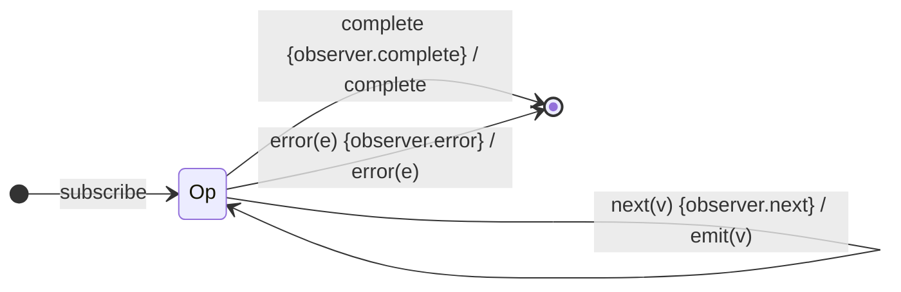

# `tap` as a Mealy Machine

> `tap(observer)` runs side-effects on each notification and forwards every
> notification **unchanged**. It is the identity projector that also reacts to
> the *terminal* symbols: unlike `map`/`filter`, `tap` can observe `complete`
> and `error` too (its callbacks fire on those edges), while the value stream
> passes through untouched.

Signature (observer form):

```ts
tap<T>(observer?: Partial<{ next: (v: T) => void; error: (e) => void; complete: () => void; … }>)
```

---

## 1. The 6-Tuple  M = (Q, Σ, Λ, δ, λ, q₀)

### Q — States

- `Op` — single operational state (no memory affecting output).
- `Done` — terminal.

### Σ — Input alphabet

- `next(v)`, `complete`, `error(e)`.

### Λ — Output alphabet

- `emit(v)` (the **original** value), `complete`, `error(e)`, `noop`.

### δ, λ

`δ(Op, next) = Op`. On **every** edge the machine first runs the matching
side-effect callback (`observer.next`/`complete`/`error`), then forwards the
original notification unchanged. The Mealy output is the *identity* on the input
notification — the side-effect is a property of the edge, not of `λ`'s value.

### q₀ — Initial state

`q₀ = Op`.

---

## 2. State Transition Table (STT)

| # | Current state | Input (Σ)  | Side-effect           | Next state | Output (λ)   |
|---|---------------|------------|-----------------------|------------|--------------|
| 1 | `Op`          | `next(v)`  | `observer.next(v)`    | `Op`       | `emit(v)`    |
| 2 | `Op`          | `complete` | `observer.complete()` | `Done`     | `complete`   |
| 3 | `Op`          | `error(e)` | `observer.error(e)`   | `Done`     | `error(e)`   |

Every edge forwards the original notification; the distinguishing feature is the
side-effect column, which fires on all three symbols.

---

## 3. State Transition Diagram (STD)



(`{…}` denotes the side-effect fired on the edge; `/` is the forwarded output.)

---

## 4. From STT rows to test cases

- **Row 1** — assert values pass through unchanged **and** the `next` callback
  observed each value (collect into an external array).
- **Row 2** — completion forwarded and `complete` callback fired.
- **Row 3** — error forwarded and `error` callback fired.

See [`tests/13-tap.test.ts`](../../tests/13-tap.test.ts).

---

## Relationship to the family

`tap` is the identity-`λ` projector that reacts to **all** of Σ (not just
`next`). It is the bridge between the pure projectors (`map`/`filter`) and
operators that genuinely observe termination. See
[`09-transformation-family.md`](../09-transformation-family.md).
