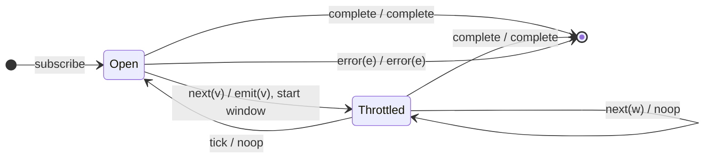

# `throttle` as a Mealy Machine

> `throttle(durationSelector, config?)` opens a silence window on a value and,
> under the default `{ leading: true, trailing: false }` config, emits the
> **first** (leading) value, suppressing the rest until the window closes. It is
> the duration-selector generalization of `throttleTime` (Session 1).

Signature:

```ts
throttle<T>(durationSelector: (value: T) => ObservableInput<any>, config?: ThrottleConfig)
```

---

## 1. The 6-Tuple  M = (Q, Σ, Λ, δ, λ, q₀)

### Q — States

- `Open` — gate open; the next value emits.
- `Throttled` — silence window active; values suppressed (default config).
- `Done` — terminal.

### Σ — Input alphabet

- `next(v)`, `complete`, `error(e)`, plus `tick` (the duration observable fires).

### Λ — Output alphabet

- `emit(x)`, `complete`, `error(e)`, `noop`.

### δ, λ

In `Open`, a value emits **immediately** (leading) and opens a window. Values
arriving during the window are suppressed; when the window closes the gate
reopens. (The `tick` itself is silent under the default config — contrast
[`audit`](audit.md).)

### q₀ — Initial state

`q₀ = Open`.

---

## 2. State Transition Table (STT)

| # | State       | Input      | Next / Output                                 |
|---|-------------|------------|-----------------------------------------------|
| 1 | `Open`      | `next(v)`  | `Throttled`; start duration; `emit(v)` (leading)|
| 2 | `Throttled` | `next(w)`  | `Throttled`; `noop` (suppressed)              |
| 3 | `Throttled` | `tick`     | `Open`; `noop` (silent under default config)  |
| 4 | any         | `complete` | `Done`; `complete`                            |
| 5 | any         | `error(e)` | `Done`; `error(e)`                            |

Row 1 emits on the leading edge — the defining contrast with `audit`'s trailing
emit.

---

## 3. State Transition Diagram (STD)



---

## 4. From STT rows to test cases

- **Rows 1-3** — emits the leading value, silences the window.

See [`tests/63a-throttle.test.ts`](../../tests/63a-throttle.test.ts).

---

## Relationship to the family

`throttle` is the leading-edge silence window; [`audit`](audit.md) is its
trailing dual. `throttleTime(d)` = `throttle(() => timer(d), config)`. See
[`14-time-family.md`](../14-time-family.md).
