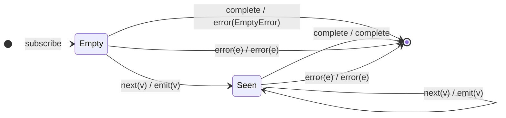

# `throwIfEmpty` as a Mealy Machine

> `throwIfEmpty(errorFactory?)` passes every source value through unchanged, but
> if the source completes **without ever emitting**, it errors with
> `errorFactory()` (default `EmptyError`) instead of completing. It is the
> error-raising sibling of [`defaultIfEmpty`](defaultIfEmpty.md) — the same
> one-bit `hasValue` latch, with the empty-completion edge raising an error
> rather than emitting a default. It powers the empty-policy of
> `first`/`last`/`elementAt`.

Signature:

```ts
throwIfEmpty<T>(errorFactory?: () => any)
```

---

## 1. The 6-Tuple  M = (Q, Σ, Λ, δ, λ, q₀)

### Q — States

- `Empty` — no value seen yet.
- `Seen` — at least one value has passed.
- `Done` — terminal.

### Σ — Input alphabet

- `next(v)`, `complete`, `error(e)`.

### Λ — Output alphabet

- `emit(v)`, `complete`, `error(e)`, `noop`.

### δ, λ

The first value flips `Empty → Seen` and passes through; subsequent values pass
through. On `complete` from `Empty`, raise `error(errorFactory())`; from `Seen`,
complete normally.

### q₀ — Initial state

`q₀ = Empty`.

---

## 2. State Transition Table (STT)

| # | State   | Input (Σ)  | Guard       | Next state | Output (λ)                        |
|---|---------|------------|-------------|------------|-----------------------------------|
| 1 | `Empty` | `next(v)`  | —           | `Seen`     | `emit(v)`                         |
| 2 | `Seen`  | `next(v)`  | —           | `Seen`     | `emit(v)`                         |
| 3 | `Empty` | `complete` | never saw   | `Done`     | `error(errorFactory())` (EmptyError) |
| 4 | `Seen`  | `complete` | saw ≥ 1     | `Done`     | `complete`                        |
| 5 | any     | `error(e)` | —           | `Done`     | `error(e)`                        |

Row 3 is the only difference from `defaultIfEmpty`: it errors instead of
emitting a default.

---

## 3. State Transition Diagram (STD)



---

## 4. From STT rows to test cases

- **Rows 1/2** — non-empty source passes through and completes normally.
- **Row 3** — empty source errors with `EmptyError` (or a custom error).

See [`tests/46-throwIfEmpty.test.ts`](../../tests/46-throwIfEmpty.test.ts).

---

## Relationship to the family

`throwIfEmpty` is [`defaultIfEmpty`](defaultIfEmpty.md) with Row 3 raising an
error instead of emitting — the engine behind the empty policy of
[`first`](first.md)/[`last`](last.md)/[`elementAt`](elementAt.md). See
[`11-aggregation-family.md`](../11-aggregation-family.md).
