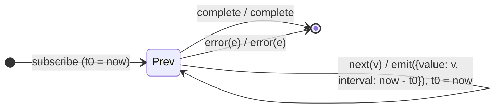

# `timeInterval` as a Mealy Machine

> `timeInterval()` wraps every value into `{ value, interval }`, where `interval`
> is the time elapsed since the **previous** emission (the first is measured from
> subscription). It keeps one number of state — the previous timestamp — making
> it a numeric `pairwise`.

Signature:

```ts
timeInterval<T>(scheduler?: SchedulerLike): OperatorFunction<T, TimeInterval<T>>
```

---

## 1. The 6-Tuple  M = (Q, Σ, Λ, δ, λ, q₀)

### Q — States

- `Prev(t0)` — the timestamp of the previous emission (initialised to the
  subscription time).
- `Done` — terminal.

### Σ — Input alphabet

- `next(v)`, `complete`, `error(e)`.

### Λ — Output alphabet

- `emit({ value, interval })`, `complete`, `error(e)`.

### δ, λ

Each `next(v)` emits `{ value: v, interval: now − t0 }` and updates `t0 := now`.

### q₀ — Initial state

`q₀ = Prev(subscribeTime)`.

---

## 2. State Transition Table (STT)

| # | State      | Input (Σ)  | Next       | Output (λ)                                       |
|---|------------|------------|------------|--------------------------------------------------|
| 1 | `Prev(t0)` | `next(v)`  | `Prev(now)`| `emit({ value: v, interval: now − t0 })`         |
| 2 | `Prev(t0)` | `complete` | `Done`     | `complete`                                       |
| 3 | `Prev(t0)` | `error(e)` | `Done`     | `error(e)`                                       |

---

## 3. State Transition Diagram (STD)



---

## 4. From STT rows to test cases

- **Row 1** — each value reports the gap since the previous emission.

See [`tests/65b-timeInterval.test.ts`](../../tests/65b-timeInterval.test.ts).

---

## Relationship to the family

`timeInterval` is a one-number accumulator (a numeric `pairwise`), contrasting
with the stateless [`timestamp`](timestamp.md). See
[`14-time-family.md`](../14-time-family.md).
