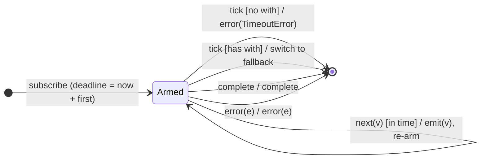

# `timeout` as a Mealy Machine

> `timeout({ first, each, with })` arms a watchdog timer that must be "fed" by
> source activity. If no value arrives within the deadline, it errors
> (`TimeoutError`) or switches to a fallback observable (`with`). Each source
> value **resets** the timer; the very first deadline can differ (`first`).

Signature:

```ts
timeout<T, O>(config: { first?, each?, with?, scheduler? })
```

---

## 1. The 6-Tuple  M = (Q, Σ, Λ, δ, λ, q₀)

### Q — States

- `Armed(deadline)` — the watchdog is counting down to `deadline`.
- `Done` — terminal (or handed off to the `with` fallback).

### Σ — Input alphabet

- `next(v)`, `complete`, `error(e)`, plus `tick` (the watchdog deadline fires).

### Λ — Output alphabet

- `emit(x)`, `complete`, `error(TimeoutError | e)`, `noop`.

### δ, λ

Each value re-arms the timer and passes through. If a `tick` wins the race
(deadline reached before the next value): error with `TimeoutError`, or switch
to the `with` observable.

### q₀ — Initial state

`q₀ = Armed(now + first)`.

---

## 2. State Transition Table (STT)

| # | State      | Input      | Guard                | Next / Output                                |
|---|------------|------------|----------------------|----------------------------------------------|
| 1 | `Armed(t)` | `next(v)`  | before deadline      | `Armed(now+each)`; `emit(v)` (reset timer)   |
| 2 | `Armed(t)` | `tick`     | deadline, no `with`  | `Done`; `error(TimeoutError)`                |
| 3 | `Armed(t)` | `tick`     | deadline, has `with` | switch to `with(info)`; mirror it            |
| 4 | `Armed(t)` | `complete` | —                    | `Done`; `complete`                           |
| 5 | `Armed(t)` | `error(e)` | —                    | `Done`; `error(e)`                           |

The watchdog is a timer racing the source: each in-time value (Row 1) re-arms
it; a `tick` that wins (Row 2/3) fires the timeout.

---

## 3. State Transition Diagram (STD)



---

## 4. From STT rows to test cases

- **Row 1** — values within the deadline pass through, resetting the timer.
- **Row 2** — a late value triggers `TimeoutError`.
- **Row 3** — with a fallback, the output switches to it on timeout.

See [`tests/66a-timeout.test.ts`](../../tests/66a-timeout.test.ts).

---

## Relationship to the family

`timeout` is the watchdog FSM; [`timeoutWith`](timeoutWith.md) is the deprecated
2-arg form of its Row-3 fallback. See
[`14-time-family.md`](../14-time-family.md).
