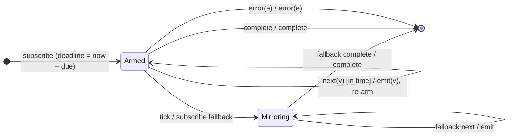

# `timeoutWith` as a Mealy Machine

> `timeoutWith(due, withObservable, scheduler?)` is the **deprecated** 2-arg form
> of [`timeout`](timeout.md)'s fallback behaviour: if no value arrives within
> `due`, switch to `withObservable` instead of erroring. Prefer
> `timeout({ each, with })` in new code.

Signature:

```ts
timeoutWith<T, R>(due: number | Date, withObservable: ObservableInput<R>, scheduler?: SchedulerLike)
```

---

## 1. The 6-Tuple  M = (Q, Σ, Λ, δ, λ, q₀)

Same watchdog skeleton as [`timeout`](timeout.md), with the timeout edge always
switching to the fallback (never erroring):

- **Q** = `{ Armed(deadline), Mirroring(fallback), Done }`.
- **Σ** = `next(v)`, `complete`, `error(e)`, plus `tick`.
- **Λ** = `{ emit(x), complete, error(e), noop }`.
- **q₀** = `Armed(now + due)`.

---

## 2. State Transition Table (STT)

| # | State      | Input      | Guard            | Next / Output                              |
|---|------------|------------|------------------|--------------------------------------------|
| 1 | `Armed(t)` | `next(v)`  | before deadline  | `Armed(now+due)`; `emit(v)` (reset timer)  |
| 2 | `Armed(t)` | `tick`     | deadline reached | `Mirroring(fallback)`; subscribe fallback  |
| 3 | `Mirroring`| fallback next/complete/error | — | mirror the fallback                        |
| 4 | `Armed(t)` | `complete` | —                | `Done`; `complete`                         |
| 5 | `Armed(t)` | `error(e)` | —                | `Done`; `error(e)`                         |

---

## 3. State Transition Diagram (STD)



---

## 4. From STT rows to test cases

- **Row 2** — a late value switches the output to the fallback observable.

See [`tests/66b-timeoutWith.test.ts`](../../tests/66b-timeoutWith.test.ts).

---

## Relationship to the family

`timeoutWith(due, fb)` ≡ `timeout({ each: due, with: () => fb })` (deprecated).
See [`timeout`](timeout.md) and [`14-time-family.md`](../14-time-family.md).
