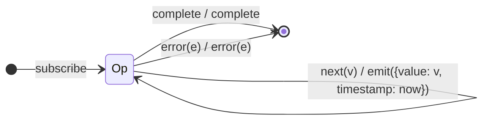

# `timestamp` as a Mealy Machine

> `timestamp()` wraps every value into `{ value, timestamp }`, where `timestamp`
> is the current scheduler clock time. It is a **stateless** single-state
> projector (like `map`), whose λ reads the absolute clock.

Signature:

```ts
timestamp<T>(scheduler?: TimestampProvider): OperatorFunction<T, Timestamp<T>>
```

---

## 1. The 6-Tuple  M = (Q, Σ, Λ, δ, λ, q₀)

### Q — States

- `Op` — single operational state (no memory).
- `Done` — terminal.

### Σ — Input alphabet

- `next(v)`, `complete`, `error(e)`.

### Λ — Output alphabet

- `emit({ value, timestamp })`, `complete`, `error(e)`.

### δ, λ

Each `next(v)` emits `{ value: v, timestamp: now }`, reading the scheduler clock
at that instant. No state is kept.

### q₀ — Initial state

`q₀ = Op`.

---

## 2. State Transition Table (STT)

| # | State | Input (Σ)  | Next  | Output (λ)                             |
|---|-------|------------|-------|----------------------------------------|
| 1 | `Op`  | `next(v)`  | `Op`  | `emit({ value: v, timestamp: now })`   |
| 2 | `Op`  | `complete` | `Done`| `complete`                             |
| 3 | `Op`  | `error(e)` | `Done`| `error(e)`                             |

---

## 3. State Transition Diagram (STD)



---

## 4. From STT rows to test cases

- **Row 1** — each value is tagged with the absolute clock time at emission.

See [`tests/65a-timestamp.test.ts`](../../tests/65a-timestamp.test.ts).

---

## Relationship to the family

`timestamp` is a stateless metadata-tagging projector (absolute clock);
[`timeInterval`](timeInterval.md) keeps the previous timestamp to report deltas.
See [`14-time-family.md`](../14-time-family.md).
