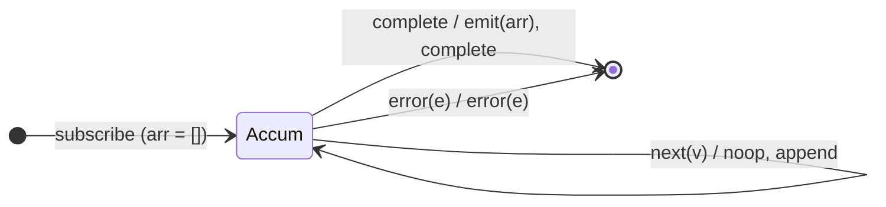

# `toArray` as a Mealy Machine

> `toArray()` collects every source value into an array and emits that single
> array **on completion**. It is `reduce` with an array accumulator seeded to
> `[]` — so unlike [`max`](max.md)/[`min`](min.md), it **always emits** on
> completion, yielding `[]` for an empty source.

Signature:

```ts
toArray<T>(): OperatorFunction<T, T[]>
```

---

## 1. The 6-Tuple  M = (Q, Σ, Λ, δ, λ, q₀)

### Q — States

- `Accum(arr)` — the collected array so far.
- `Done` — terminal.

### Σ — Input alphabet

- `next(v)`, `complete`, `error(e)`.

### Λ — Output alphabet

- `emit(T[])`, `complete`, `error(e)`, `noop`.

### δ, λ

Each value is appended silently. On `complete` the whole array is emitted, then
completion. The array seed guarantees an emission even when empty.

### q₀ — Initial state

`q₀ = Accum([])`.

---

## 2. State Transition Table (STT)

| # | State        | Input (Σ)  | Next state        | Output (λ)              |
|---|--------------|------------|-------------------|-------------------------|
| 1 | `Accum(arr)` | `next(v)`  | `Accum(arr ++ [v])`| `noop`                 |
| 2 | `Accum(arr)` | `complete` | `Done`            | `emit(arr)`, `complete` |
| 3 | `Accum(arr)` | `error(e)` | `Done`            | `error(e)`              |

---

## 3. State Transition Diagram (STD)



---

## 4. From STT rows to test cases

- **Rows 1+2** — all values collected, emitted as one array on completion.
- **Empty source** — emits `[]` (the seed) — the contrast with `max`/`min`.
- **Row 3** — error forwarded, no array emitted.

See [`tests/44-toArray.test.ts`](../../tests/44-toArray.test.ts).

---

## Relationship to the family

`toArray` is the seeded fold (always emits), contrasting with the seedless
[`max`](max.md)/[`min`](min.md) (emit nothing when empty). See
[`11-aggregation-family.md`](../11-aggregation-family.md).
