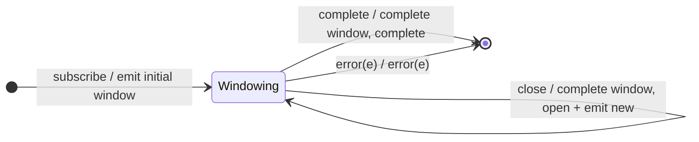

# `window` as a Mealy Machine

> `window(boundaries)` is the Observable-valued twin of [`buffer`](buffer.md):
> same external-notifier boundary logic, but it emits **nested Observables**
> instead of arrays. Each source value is forwarded into a live `Subject`; a
> boundary completes the current window and opens a new one.

Signature:

```ts
window<T>(windowBoundaries: Observable<any>)
```

---

## 1. The 6-Tuple  M = (Q, Σ, Λ, δ, λ, q₀)

### Q — States

- `Windowing(win)` — the currently open window Subject.
- `Done` — terminal.

### Σ — Input alphabet (source + boundaries)

- `next(v)`, `complete`, `error(e)`, plus `close` (a boundary emits).

### Λ — Output alphabet

- `emit(Observable)` (a new window) plus `innerNext`/`innerComplete` on each
  window Subject; `complete`, `error(e)`.

### δ, λ

A new window Observable is emitted at subscribe and after each boundary. Each
`next(v)` is forwarded into the current window. A `close` completes the current
window and opens a new one.

### q₀ — Initial state

`q₀ = Windowing(W0)` (initial window emitted immediately).

---

## 2. State Transition Table (STT)

| # | State          | Input      | Next / Output                              |
|---|----------------|------------|--------------------------------------------|
| 1 | `Windowing(W)` | `next(v)`  | `W.next(v)`; `noop` (to outer)             |
| 2 | `Windowing(W)` | `close`    | `W.complete()`; open `W'`; `emit(W')`      |
| 3 | `Windowing(W)` | `complete` | `W.complete()`; `Done`; `complete`         |
| 4 | `Windowing(W)` | `error(e)` | `W.error(e)`; `Done`; `error(e)`           |

Same boundary logic as `buffer`; Λ emits Observables (the buffer→array /
window→Observable duality).

---

## 3. State Transition Diagram (STD)



---

## 4. From STT rows to test cases

- **Rows 1-3** — each window observable (flattened with `toArray`) carries the
  values of its slice; contents mirror the `buffer` test.

See [`tests/69a-window.test.ts`](../../tests/69a-window.test.ts).

---

## Relationship to the family

`window` is the Observable-valued twin of [`buffer`](buffer.md);
[`windowWhen`](windowWhen.md) uses a per-cycle closing selector. See
[`15-buffering-windowing-family.md`](../15-buffering-windowing-family.md).
