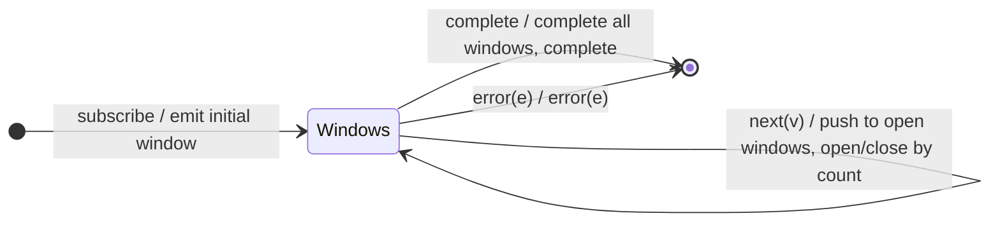

# `windowCount` as a Mealy Machine

> `windowCount(size, startWindowEvery?)` is the window analogue of `bufferCount`
> (Session 2): open a new window every `startWindowEvery` values, each carrying
> at most `size` values. With `startWindowEvery < size`, windows **overlap** (a
> value appears in several). The boundary is the value **count**.

Signature:

```ts
windowCount<T>(windowSize: number, startWindowEvery = 0)
```

---

## 1. The 6-Tuple  M = (Q, Σ, Λ, δ, λ, q₀)

### Q — States

- `Windows(openWindows, i)` — the set of currently open window Subjects and the
  running value index `i`.
- `Done` — terminal.

### Σ — Input alphabet

- `next(v)`, `complete`, `error(e)`.

### Λ — Output alphabet

- `emit(Observable)` plus inner `next`/`complete`; `complete`, `error(e)`.

### δ, λ

Each `next(v)` is pushed into every open window; a new window opens at each
`startWindowEvery` boundary, and any window that reached `size` values is closed.
The "openings" and "closings" are driven by count rather than external
observables.

### q₀ — Initial state

`q₀ = Windows({W0}, 0)` (initial window emitted immediately).

---

## 2. State Transition Table (STT)

| # | State             | Input      | Next / Output                                                      |
|---|-------------------|------------|-------------------------------------------------------------------|
| 1 | `Windows(W, i)`   | `next(v)`  | push `v` into every open window; open a new window at the `startEvery` boundary; close any window that reached `size`; `noop` / `emit(newWindow)` |
| 2 | `Windows(W, i)`   | `complete` | complete all open windows; `Done`; `complete`                     |
| 3 | `Windows(W, i)`   | `error(e)` | `Done`; `error(e)`                                                |

---

## 3. State Transition Diagram (STD)



---

## 4. From STT rows to test cases

- **Row 1** — windows open/close by value count; `startWindowEvery < size`
  produces overlapping windows.

See [`tests/71-windowCount.test.ts`](../../tests/71-windowCount.test.ts).

---

## Relationship to the family

`windowCount` is the counting cousin of [`windowToggle`](windowToggle.md) and the
Observable-valued analogue of `bufferCount` (Session 2). See
[`15-buffering-windowing-family.md`](../15-buffering-windowing-family.md).
